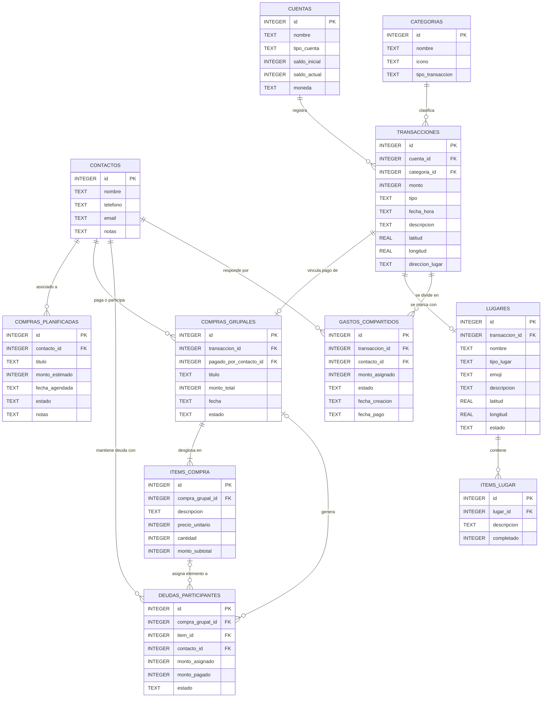

# 📱 LocalCash — Mobile Fintech 100% Offline & Private

[](https://developer.android.com/)
[](https://www.oracle.com/java/)
[-blue.svg?style=flat-square&logo=sqlite)](https://www.sqlite.org/)
[-red.svg?style=flat-square&logo=android)](https://developer.android.com/about/versions/pie/android-9.0)
[-purple.svg?style=flat-square)](https://github.com/GGallegosO/Template-SSD)
[](doc/)

**LocalCash** es una aplicación móvil Android nativa desarrollada en **Java** concebida para que los **datos financieros** operen de forma **100% local y offline**. Combina la administración de cuentas personales, el registro georreferenciado de movimientos en un mapa interactivo, pines de lugar con listas de cosas, una agenda local de contactos y la división de gastos compartidos con cobro de deudas.

El proyecto pone un énfasis crítico en la **privacidad del usuario** (cero comunicación de datos financieros con servidores externos) y en el rigor de ingeniería mediante la metodología **Spec-Driven Development (SDD)**. El mapa base usa teselas vectoriales públicas con caché local; la información financiera y las listas nunca salen del dispositivo.

---

## 🌟 Características implementadas

| Módulo | Estado | Detalle |
| :--- | :--- | :--- |
| 🔐 **Acceso local** | ✅ Feature 005 / 006 | Desbloqueo con `BiometricPrompt` + PIN de respaldo, registro inicial en dos pasos y credenciales en `EncryptedSharedPreferences` (Android Keystore). |
| 💳 **Cuentas** | ✅ Feature 007 | Múltiples cuentas (efectivo, ahorro, tarjeta, otro) con saldo de apertura, soft delete y edición gobernada por el historial. |
| 📈 **Historial de movimientos** | ✅ Feature 008 | Ingresos y egresos en pesos CLP, filtros, paginación y recálculo de saldo como proyección del libro mayor. |
| 📍 **Mapa interactivo** | ✅ Feature 009 | `MapLibre Native` + OpenFreeMap/OSM con caché de teselas: geolocalizar un movimiento, "Mi ubicación", pines por pulsación larga y navegación sin cobertura (degrada a caché o lienzo). |
| 🛒 **Pines con lista de cosas** | ✅ Feature 009 | Cada pin tiene tipo (supermercado, farmacia, restaurante…), emoji, estado abierto/cerrado reversible y checklist de elementos completables. |
| 👥 **Agenda de contactos** | ✅ Feature 011 | CRUD local de terceros con teléfono/email únicos (ignorando mayúsculas y `NULL`); el borrado está bloqueado si tiene compromisos (`CONTACTO_EN_USO`). |
| 🧾 **División de gastos compartidos** | ✅ Feature 012 | Un egreso se marca **compartido** y se reparte entre contactos en **partes iguales** (usuario implícito incluido: N+1, residuo de a 1 peso) o **montos personalizados**. Resumen de deudas por contacto, detalle con **Pagar** individual y **Pagar todo**, con cobro atómico que acredita el saldo. |
| 🗓️ **Planificación de compras** | ⏳ Pendiente (Fase 2) | Agenda de compras futuras y su materialización en un movimiento. Definida en `data-model.md` (`COMPRAS_PLANIFICADAS`), sin feature ejecutada. |
| 🧮 **Compras grupales por ítem** | ⏳ Pendiente (Fase 3) | Desglose con `COMPRAS_GRUPALES` + `ITEMS_COMPRA` + `DEUDAS_PARTICIPANTES`, abonos parciales y deudas en direction inversa ("les debo"). Esquema ya definido en la constitución. |

> La fuente de verdad del alcance es `spec/constitution/roadmap.md`; el detalle de cada feature está en
> `spec/features/NNN-*/` y su registro de memoria en `doc/NNN-*.md`.

---

## 🏗️ Arquitectura y Pilar de Ingeniería (SDD)

El desarrollo no improvisa líneas de código: sigue **Spec-Driven Development (SDD)** guiado por la plantilla [Template-SSD](https://github.com/GGallegosO/Template-SSD). El orden es obligatorio: `spec.md` (QUÉ) → `plan.md` (CÓMO) → `tasks.md` (ejecución) → registro en `doc/`.

```text
.
├── .agent.md                      # Contrato maestro de reglas, comandos y prohibiciones
├── AGENTS.md                      # Manual operativo y gotchas (IA / devs nuevos)
├── spec/                          # CONTRATOS TÉCNICOS (Qué y Por qué)
│   ├── constitution/              # Misión, Tech Stack, Modelo de Datos y Roadmap
│   │   ├── mission.md
│   │   ├── tech-stack.md
│   │   ├── data-model.md          # ERD + DDL canónico (Single Source of Truth)
│   │   └── roadmap.md
│   └── features/                  # 005, 006, 007, 008, 009, 011, 012 (spec/plan/tasks)
├── doc/                           # MEMORIA (000…012: decisiones, lecciones, verificación)
└── app/                           # Código Android, arquitectura por capas
    └── src/main/java/com/localcash/
        ├── ui/                    # Activities, adapters, ViewModels, traducción de errores a texto
        ├── domain/                # Reglas de negocio puras (sin Android ni Room)
        └── data/                  # Entidades, DAOs, migraciones y repositorios Room
```

**Regla de dependencias:** `ui → domain ← data`. Los cálculos de dinero viven en `domain/` y se prueban
en JVM sin dispositivo; la UI solo orquesta y nunca decide reglas.

---

### Decisión de Persistencia y Precisión Financiera

- 💰 **Montos y saldos:** `INTEGER` (`long` en Java) en **pesos CLP directos**, sin centavos en
  circulación desde 1984. Se descarta `REAL`/`double`: en IEEE 754 `0.1 + 0.2 = 0.30000000000000004`
  y la deriva aparecería justo en el saldo que ve el usuario. El reparto usa aritmética entera y el
  residuo se asigna de a 1 peso, de modo que las partes cuadran exactas.
- 🔄 **Saldo como proyección:** `TRANSACCIONES` es la única fuente de verdad; `CUENTAS.saldo` solo se
  mueve con **aritmética atómica** (`SET saldo = saldo + :monto`), nunca leer-calcular-escribir. El
  invariante `saldo = saldo_inicial + Σ ingresos − Σ egresos` está protegido por tests.
- 🧾 **Cobro de una deuda compartida:** marcar una parte como pagada abre **una sola transacción** que
  valida el estado, cierra la parte, asienta un ingreso automático "Devolución gasto compartido" en la
  cuenta del egreso original y suma el saldo. Si un paso falla, no se aplica ninguno.
- 🙋 **Parte del usuario implícita:** la app no tiene perfil propio en la base. El reparto igual divide
  entre N+1 (usuario + N contactos), pero solo se persisten las partes de los contactos; el egreso
  completo ya representa el gasto del usuario.
- 🗺️ **Coordenadas:** `REAL` en grados WGS84, el tipo que consume MapLibre, con filtro por caja
  envolvente indexado.
- 🚫 **Sin migraciones destructivas:** `fallbackToDestructiveMigration()` y `DROP TABLE` están
  prohibidos; la versión del esquema es `PRAGMA user_version` (hoy **Room v5**) y toda migración se
  valida con `MigrationTestHelper`.

---

## 📊 Modelo de Datos (ERD)

El contrato canónico (`spec/constitution/data-model.md`, revisión v3) define **11 tablas**. El archivo
SQLite real del app tiene hoy **6 materializadas** con Room (`cuentas`, `transacciones`, `LUGARES`,
`ITEMS_LUGAR`, `CONTACTOS`, `GASTOS_COMPARTIDOS`); las cinco restantes son el hito futuro de compras
planificadas y grupales.



> ⚠️ El diagrama de arriba refleja el contrato canónico, no el estado de la base: **la fuente de verdad es
> `spec/constitution/data-model.md`** (diccionario, invariantes I-1..I-16, índices y DDL del Apéndice A).
> Si este README y ese archivo divergen, gana el documento de la constitución.
>
> Notas de implementación: Room no expresa `CHECK` ni `DEFAULT`, así que los dominios cerrados de
> `estado` y la coherencia `estado` ↔ `fecha_pago` los valida el dominio/repositorio con tests propios.

---

## 🛠️ Stack Tecnológico

| Capa / Componente | Selección real | Versión | Justificación técnica |
| :--- | :--- | :--- | :--- |
| **Lenguaje** | Java (source/target 11) | JDK 17+ para Gradle | Android nativo en Java, sin capas de traducción. |
| **Build** | Android Gradle Plugin / Gradle Wrapper | AGP 9.3.3 · Gradle 9.5 | Pipeline reproducible con wrapper, sin dependencias globales. |
| **SDK** | `compileSdk` / `targetSdk` 36 · `minSdk` 28 | API 28+ | SQLite 3.8+ garantizado en el rango soportado; `BiometricPrompt` desde API 23+. |
| **UI** | AndroidX + Material Components | Material 1.14.0 | Componentes Material 3 (BottomSheet, Chips, TextInputLayout) sin WebView ni frameworks JS. |
| **Persistencia** | Room (Room Migrations + `MigrationTestHelper`) | 2.6.1 | Valida SQL en tiempo de compilación y fija el esquema exportado en `app/schemas/` (v5). |
| **Base de datos** | SQLite local, archivo único `.db` | 3.8+ | Motor relacional embebido: pilar 100% offline sin servidor. |
| **Mapas** | MapLibre Native + OpenFreeMap/OSM | 13.4.0 | Vectorial sin API keys; las teselas se cachean y ningún dato financiero sale del dispositivo. |
| **Seguridad** | AndroidX Biometric + `EncryptedSharedPreferences` | Biometric 1.2.0-alpha05 · security-crypto 1.1.0-alpha06 | Biometría del SO y cifrado respaldado por Android Keystore. |
| **Testing** | JUnit 4 · Robolectric · Room `MigrationTestHelper` · Espresso | JUnit 4.13.2 · Robolectric 4.17 · Espresso 3.7.0 | Lógica de dominio y DAOs probados en JVM sin dispositivo; E2E con `connectedCheck`. |
| **Calidad** | Android Lint + cobertura ≥ 70% en dominio/DAOs | — | Cero advertencias nuevas aceptadas (el repo arrastra un baseline histórico). |

📄 Detalle y alternativas descartadas: `spec/constitution/tech-stack.md`. Ninguna dependencia entra al
proyecto sin estar registrada allí primero.

---

## 🧪 Estado de las pruebas

`./gradlew testDebugUnitTest` → **127 tests en verde**, sin dispositivo (JVM + Robolectric):

| Suite | Cubre |
| :--- | :--- |
| `GastoCompartidoServiceTest` (28) | Reparto igual con y sin residuo, N+1, monto insuficiente, 0 contactos, duplicados, personalizada. |
| `GastoCompartidoDaoTest` (9) | Inserción por lotes, índice único, orden por monto, resumen Σ, segundo cobro: 0 filas, `CASCADE`, `RESTRICT`, `PRAGMA foreign_keys`. |
| `GastoCompartidoIntegrationTest` (2) | Flujo completo sin UI: egreso → reparto → cobro → saldo con invariante I-1. |
| `MigracionV4V5Test` (5) / `MigracionV2V3Test` (4) | Migraciones reales con `MigrationTestHelper` y `foreign_key_check` limpio. |
| `ContactoDaoTest` (14), `LugarDaoTest` (12), `LugarServiceTest` (19), `ContactoServiceTest` (12), `TransaccionServiceTest` (8), `ItemLugarDaoTest` (6), `CuentaDaoTest` (3), `TransaccionDaoTest` (3), `TransaccionViewModelDivisionTest` (2) | Features 007–012: CRUD, unicidad, cascadas, validaciones de saldo, coordenadas y estado del reparto. |

`connectedCheck` (Espresso) requiere emulador o dispositivo activo; la UI de las últimas features se
validó manualmente en emulador.

---

## 🚀 Compilación y Ejecución

### Requisitos previos
- **Android Studio** con soporte para AGP 9.x (Narwhal/Postman o superior).
- **Android SDK Platform 36** y Build-Tools compatibles (`compileSdk 36`).
- **JDK 17+** (se prueba con JetBrains OpenJDK 21).
- Un emulador o dispositivo en **Android 9 (API 28) o superior** para `installDebug`/`connectedCheck`.

### Primer arranque

```bash
git clone https://github.com/GGallegosO/LocalCash.git
cd LocalCash
./gradlew assembleDebug          # el wrapper resuelve las dependencias: no hay "npm install"
```

### Comandos de desarrollo (Gradle Wrapper)

```bash
./gradlew assembleDebug        # APK de debug
./gradlew lint                 # análisis estático (línea base: cero avisos nuevos)
./gradlew testDebugUnitTest    # pruebas unitarias y de integración en JVM (Robolectric)
./gradlew connectedCheck       # pruebas de UI: requiere emulador/dispositivo activo
./gradlew installDebug         # compila e instala en el dispositivo
./gradlew assembleRelease      # binario de release (firmado vía Play Console / GitHub Releases)
```

**Orden antes de cerrar una feature** (`Definition of Done` de `tasks.md`):
`lint` → `testDebugUnitTest` → `connectedCheck` → `assembleDebug`.

### Privacidad y permisos
- Sin backend, sin analítica y sin cuentas: los datos financieros viven solo en el dispositivo.
- Única red permitida y documentada: descarga de teselas vectoriales públicas para el mapa base, con
  caché local y degradación a pantalla navegable sin cobertura. Nunca se envían cuentas, movimientos,
  listas ni credenciales al proveedor de mapas.

---

## 🗺️ Dónde empezar a leer

| Pregunta | Archivo |
| :--- | :--- |
| Qué construimos y por qué | `spec/constitution/mission.md` |
| Qué stack está permitido (y qué se descartó) | `spec/constitution/tech-stack.md` |
| Esquema, ERD, DDL canónico e invariantes | `spec/constitution/data-model.md` |
| Orden de entrega y estado de hitos | `spec/constitution/roadmap.md` |
| Reglas, comandos y prohibiciones para agentes | `.agent.md` · `AGENTS.md` |
| Qué hizo cada feature y qué se decidió | `spec/features/NNN-*/` y `doc/NNN-*.md` |

---

## 👤 Autor

**Gustavo Gallegos**
- **GitHub:** [@GGallegosO](https://github.com/GGallegosO)
- **Proyecto:** [LocalCash Repository](https://github.com/GGallegosO/LocalCash)

> Licencia: aún no se ha publicado archivo `LICENSE` en el repositorio. Hasta que se agregue, el
> proyecto se distribuye sin licencia declarada.
