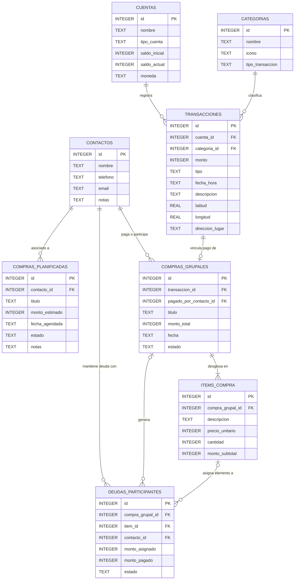

# 📱 LocalCash — Mobile Fintech 100% Offline & Private

[](https://developer.android.com/)
[](https://www.oracle.com/java/)
[](https://www.sqlite.org/)
[-purple.svg?style=flat-square)](https://github.com/GGallegosO/Template-SSD)
[](LICENSE)

**LocalCash** es una aplicación móvil Android nativa desarrollada en **Java** concebida para operar **100% de forma local y offline**. Combina la administración de cuentas financieras personales, el registro georreferenciado de movimientos en mapa, la planificación de compras futuras y un motor avanzado para la división de gastos compartidos y deudas entre contactos.

El proyecto pone un énfasis crítico en la **privacidad absoluta del usuario** (cero comunicación con servidores externos) y en el rigor de ingeniería mediante la metodología **Spec-Driven Development (SDD)**.

---

## 🌟 Características Principales

- 🔐 **Seguridad Biométrica Local:** Acceso protegido mediante la API nativa `BiometricPrompt` (huella dactilar).
- 💳 **Gestión Multicuenta y Transacciones:** Administración de fuentes de dinero (Efectivo, Tarjetas, Ahorros) e historial de ingresos/egresos.
- 📍 **Mapa Espacial Interactivo:** Visualización y filtrado offline de movimientos mediante coordenadas GPS (`latitud`, `longitud`) integradas con `osmdroid`.
- 🗓️ **Planificación de Compras:** Programación de compras e historial con presupuestos estimados.
- 👥 **Gastos Compartidos y División de Deudas:** Motor de cuentas claras para compras grupales con dos modalidades (División equitativa global o desglose itemizado por producto).

---

## 🏗️ Arquitectura y Pilar de Ingeniería (SDD)

El desarrollo del proyecto no improvisa líneas de código: sigue la metodología **Spec-Driven Development (SDD)** guiada por la plantilla [Template-SSD](https://github.com/GGallegosO/Template-SSD).

```text
.
├── .agent.md                      # Contrato maestro de reglas y estándares de código
├── AGENTS.md                      # Manual operativo y gotchas de SQLite para IA/Devs
├── spec/                          # CONTRATOS TÉCNICOS (Qué y Por qué)
│   ├── constitution/              # Misión, Tech Stack, Modelo de Datos y Roadmap
│   │   ├── mission.md
│   │   ├── tech-stack.md
│   │   ├── data-model.md          # ERD y DDL oficial (Single Source of Truth)
│   │   └── roadmap.md
│   └── features/                  # Especificaciones por funcionalidad (spec/plan/tasks)
├── doc/                           # MEMORIA INMUTABLE (Registros de tareas ejecutadas)
└── app/                           # Código Fuente Android (Clean Architecture: UI, Domain, Data)
    └── src/main/java/com/localcash/
```

---

### Decisión de Persistencia y Precisión Financiera

Para garantizar la integridad matemática en los cálculos financieros offline (evitando errores binarios de coma flotante IEEE 754) [1, 13]:
- 💰 **Montos y Saldos:** Se almacenan estrictamente como números enteros (**`INTEGER`**) en la unidad mínima de moneda (centavos) [1].
- 🗺️ **Coordenadas GPS:** Se almacenan como **`REAL`** para filtrado por radio geográfico [1, 7].

---

## 📊 Modelo de Datos (ERD)

El esquema relacional SQLite está compuesto por 8 tablas interconectadas [14, 15]:



## 🛠️ Stack Tecnológico

| Capa / Componente | Tecnología Seleccionada | Justificación Técnica |
| :--- | :--- | :--- |
| **Lenguaje** | Java 8+ / JDK 11 | Compatibilidad nativa en Android Studio. |
| **Persistencia** | SQLite (`SQLiteOpenHelper` → Room) | Persistencia relacional local de alto rendimiento y cero dependencia de servidores. |
| **Mapas & Geometría** | `osmdroid` 6.x | Renderizado de mapa interactivo 100% offline sin llaves API pagadas. |
| **Seguridad** | `BiometricPrompt` API | Estándar de la plataforma Android para autenticación biométrica local. |
| **UI Components** | Material Design Components | Interfaz limpia, responsiva y adaptable. |
| **Testing** | JUnit, Mockito, Robolectric, Espresso | Cobertura objetivo ≥ 70% en capas de Dominio y DAOs. |

---

## 🚀 Compilación y Ejecución

### Requisitos Previos
- **Android Studio:** Ladybug | 2024.2+ o superior.
- **Android SDK:** v34 (API Level 34).
- **JDK:** Version 11 instalada y configurada.

### Comandos de Desarrollo (Gradle Wrapper)

```bash
# Compilar el proyecto en modo Debug
./gradlew assembleDebug

# Ejecutar Pruebas Unitarias (Robolectric / JUnit)
./gradlew testDebugUnitTest

# Ejecutar Pruebas de Integración y UI (Dispositivo/Emulador conectado)
./gradlew connectedCheck

# Instalar APK de desarrollo en emulador/dispositivo
./gradlew installDebug

# Análisis Estático de Código
./gradlew lint
```

---

## 👤 Autor

**Gustavo Gallegos**  
- **GitHub:** [@GGallegosO](https://github.com/GGallegosO)  
- **Proyecto:** [LocalCash Repository](https://github.com/GGallegosO/LocalCash)
---


