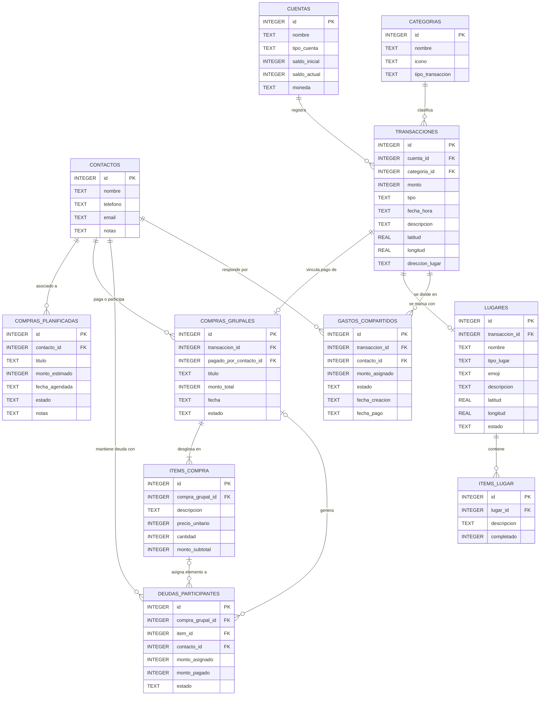

# data-model.md — Modelo de Datos y Diagrama de Base de Datos

> **Propósito de este archivo:** Registrar la decisión de esquema de datos del proyecto: entidades,
> relaciones, claves y diagrama. Esta es la **fuente única de verdad (single source of truth)** del
> modelo de datos. Cualquier feature que lea o escriba datos debe respetar lo aquí definido; si una
> feature necesita cambiar el esquema, primero se actualiza este archivo (y se registra en `doc/`).
>
> **¿Dónde ubicar esta información?** Aquí, en `spec/constitution/data-model.md`, porque el modelo
> de datos es una **decisión estructural transversal** (afecta a todo el sistema), no el detalle de
> una feature individual. Las decisiones *de selección tecnológica* (qué motor de BD y por qué)
> viven en `tech-stack.md`; el *esquema concreto* vive aquí. El código de migraciones/DAL es solo la
> implementación reflejada de este documento.
>
> **Regla de sincronización:** Si las migraciones reales y este documento divergen, hay un bug de
> documentación. Se corrige este archivo en el mismo PR que modifica el esquema.

---

## 1. Resumen de la Decisión

| Campo                        | Valor                                        |
|------------------------------|----------------------------------------------|
| Motor de persistencia        | SQLite 3.8+ (`minSdk` 28), vía `SQLiteOpenHelper` en Fases 1-2 y `Room` desde la Fase 3 (referencia a su fila en `tech-stack.md`) |
| Modelo de datos              | RELACIONAL |
| Fecha de aprobación          | 2026-09-28                                  |
| Aprobado por                 | GG (`doc/000-initial-setup.md` §1)           |
| Tarea que originó la decisión| `003-modelo-datos` (archivo en `/doc/`)      |
| Última revisión              | 2026-10-26 (Feature `012-division-gastos`) |
| Estado del esquema           | v2 vigente (10 tablas); v3 en preparación (11 tablas) |

> **Justificación en una línea:** se prioriza la integridad referencial sobre la flexibilidad de
> esquema porque el dominio tiene relaciones estables (un movimiento pertenece a una cuenta, una
> compra grupal se desglosa en ítems y genera deudas) y toda la información es local y del propio
> usuario, sin servidor que pueda normalizar inconsistencias.

**Alcance.** Persistencia relacional local en SQLite para la gestión financiera personal y grupal
**100% offline para los datos del usuario** y con **privacidad absoluta**: 11 tablas que cubren
cuentas, movimientos geolocalizados, categorías, agenda local de contactos, lugares/pines con sus
listas de cosas, partes de un egreso compartido con su estado de cobro y el ciclo completo de gasto
compartido futurible (compra planificada → compra grupal → ítems → deuda por participante). El mapa
base puede descargar teselas públicas con caché local, pero los datos financieros y las listas nunca
salen del dispositivo. Quedan fuera de alcance la
sincronización, el multiusuario, la conversión de moneda, la auditoría de cambios y cualquier
construcción dependiente de un servidor remoto, conforme a los anti-objetivos de `mission.md` §3 y a
`tech-stack.md` §3.

---

/renam

> *Guía:* Dibuja el diagrama en **Mermaid** dentro de este bloque. No pegues imágenes binarias
> como única fuente: el texto versiona, se revisa en PR y los agentes pueden leerlo. Si además
> quieres una imagen renderizada, guárdala en `spec/constitution/diagrams/` y enlázala abajo,
> pero el Mermaid manda.



**Imagen renderizada (opcional, complementaria):**



### 2.1 Lectura de las cardinalidades

| Relación                                  | Cardinalidad | Qué significa en el dominio                                                                    |
|-------------------------------------------|--------------|------------------------------------------------------------------------------------------------|
| `CONTACTOS` → `COMPRAS_PLANIFICADAS`      | 1:N          | Una planificación pertenece a un contacto y es de él. `contacto_id` es `NOT NULL`.              |
| `CONTACTOS` → `COMPRAS_GRUPALES`          | 1:N opcional | Un contacto puede haber pagado muchas compras. `NULL` significa que pagó el usuario principal (§4.1). |
| `CONTACTOS` → `DEUDAS_PARTICIPANTES`      | 1:N          | Un contacto puede acumular deudas en muchas compras.                                           |
| `CONTACTOS` → `GASTOS_COMPARTIDOS`        | 1:0..N       | Un contacto puede responder por la parte de muchos egresos compartidos. `contacto_id` es `NOT NULL`. |
| `CUENTAS` → `TRANSACCIONES`               | 1:N          | Una cuenta es el contenedor de los movimientos; sin cuenta no hay movimiento.                   |
| `CATEGORIAS` → `TRANSACCIONES`            | 1:N opcional | La clasificación es opcional: un movimiento sin categoría sigue siendo válido.                  |
| `TRANSACCIONES` → `COMPRAS_GRUPALES`      | 1:0..1       | Un movimiento genera **a lo sumo una** compra grupal. La compra puede existir sin movimiento (`NULL`). |
| `TRANSACCIONES` → `LUGARES`               | 1:0..1       | Un movimiento puede originar **a lo sumo un pin** vinculado. Un lugar independiente tiene `transaccion_id` `NULL`. |
| `TRANSACCIONES` → `GASTOS_COMPARTIDOS`    | 1:0..N (mín. 1 si se comparte) | Un egreso común no tiene partes; si el usuario lo marca compartido, tiene **al menos una** parte (I-12). |
| `LUGARES` → `ITEMS_LUGAR`                 | 1:0..N       | Un lugar puede no tener lista de cosas o tener muchos elementos; el elemento no existe sin lugar. |
| `COMPRAS_GRUPALES` → `ITEMS_COMPRA`       | 1:N (mín. 1) | Una compra grupal se desglosa en al menos un ítem; no hay compra vacía.                        |
| `COMPRAS_GRUPALES` → `DEUDAS_PARTICIPANTES` | 1:0..N     | Una compra puede no tener deudas (compra propia, sin reparto) o generar una por participante.   |
| `ITEMS_COMPRA` → `DEUDAS_PARTICIPANTES`   | 1:0..N       | Un ítem puede no tener deudas asignadas, y una deuda puede no imputarse a ningún ítem concreto. |

> **Lectura adoptada del `|o` a la izquierda.** En las dos últimas relaciones, `|o` significa "esta
> compra o este ítem puede tener cero o muchas deudas", no "una deuda puede existir sin compra".
> Por eso `ITEMS_COMPRA.compra_grupal_id` es `NOT NULL` en el esquema (una deuda sin compra no
> tiene significado de dominio y rompería el invariante I-4) mientras que
> `DEUDAS_PARTICIPANTES.item_id` sí admite `NULL` (una deuda puede repartirse sobre el total sin
> imputarse a un ítem). Ambas decisiones son coherentes con el verbo del diagrama: *genera* y
> *asigna elemento a*.


## 3. Diccionario de Entidades

> *Guía:* Una subsección por entidad. Incluye siempre: propósito (una frase), campos con tipo
> lógico (no sintaxis de un motor concreto → se mantiene agnóstico), claves e índices, y reglas
> de negocio asociadas.

> **Adaptación de esta columna al proyecto.** El stack ya está congelado en `tech-stack.md`, así que
> la columna *Tipo lógico* de la plantilla se materializa como **Tipo SQLite**: el tipo lógico sigue
> siendo legible porque cada celda indica su unidad (pesos CLP, grados, unidades, ISO-8601). Del
> mismo modo, *Clave* y las restricciones se fusionan en **Clave / Restricción** (PK/FK, `NOT NULL`,
> `DEFAULT`, `CHECK`) y la *regla de negocio* se integra en la última columna. El resto de la
> estructura —propósito, ciclo de vida, índices y eliminación por entidad— se mantiene sin cambios.

### Convención de tipos y precisión financiera

| Familia de columnas | Tipo SQLite | Unidad | Por qué |
|---|---|---|---|
| Montos, saldos y precios | `INTEGER` | pesos CLP (unidad mínima, sin centavos en circulación desde 1984) | Aritmética exacta: el saldo se acumula por sumas repetidas y el reparto debe cuadrar al peso. En IEEE 754 (`REAL`), `0.1 + 0.2 = 0.30000000000000004` y el error aparecería en el saldo que ve el usuario. |
| Coordenadas | `REAL` | grados WGS84 (`double`) | Es el tipo que consume MapLibre (`LatLng`), sin conversión por lectura. A 7 decimales la resolución es de ~1 cm, muy por debajo del error del GPS. |
| Fechas y horas | `TEXT` | ISO-8601 UTC | El orden lexicográfico coincide con el cronológico, así que `ORDER BY fecha_hora` usa el índice sin conversión y el `.db` exportado queda legible. |
| Estados | `TEXT` + `CHECK` | dominio cerrado | El motor rechaza valores fuera de dominio en el punto de escritura. |
| Cantidades de producto | `INTEGER` | unidades | Es un conteo, no dinero: por eso no lleva centavos ni `REAL`. |
| Ids | `INTEGER` | correlativo `AUTOINCREMENT` | Monótonos y nunca reutilizados, para que un respaldo importado no colisione con referencias ya guardadas. |

**Regla de conversión:** el paso de `BigDecimal` a pesos CLP ocurre **solo** en la capa de dominio, en
un único par de funciones; ningún DAO acepta `double`. Ningún DAO escribe `CUENTAS.saldo_actual`
leyendo antes el valor: se actualiza con aritmética atómica (§4.2).

### 3.1 CONTACTOS

- **Propósito:** Agenda local de terceros con los que el usuario comparte gastos. No contiene al
  usuario principal: la app no tiene perfil propio en la base de datos (§4.1).
- **Ciclo de vida:** creada por el usuario (`alta manual`, sin importación de la agenda del sistema);
  eliminable con `RESTRICT` mientras tenga compromisos (§4.2). Se edita en cualquier momento.

| Campo | Tipo SQLite | Clave / Restricción | Nullable | Descripción y regla de negocio |
|---|---|---|---|---|
| `id` | `INTEGER` | `PK` · `AUTOINCREMENT` | No | Identificador local, generado por el motor. |
| `nombre` | `TEXT` | `NOT NULL` · `CHECK (length(trim(nombre)) > 0)` | No | Nombre visible. Obligatorio y no vacío: un contacto anónimo no aporta nada en un reparto de deudas. |
| `telefono` | `TEXT` | `COLLATE NOCASE` · índice único parcial | Sí | Identificador opcional. `NOCASE` e índice único ignoran los `NULL`, así que puede quedar vacío sin estorbar. |
| `email` | `TEXT` | `COLLATE NOCASE` · índice único parcial | Sí | Identificador opcional con las mismas reglas que `telefono`. |
| `notas` | `TEXT` | — | Sí | Notas libres; no se indexa ni se busca. |

- **Índices:** `ux_contactos_telefono` y `ux_contactos_email`, ambos únicos parciales
  (`WHERE ... IS NOT NULL`), para impedir que el mismo contacto se capture dos veces.
- **Eliminación:** FÍSICA, con `ON DELETE RESTRICT` desde `COMPRAS_PLANIFICADAS`,
  `COMPRAS_GRUPALES`, `DEUDAS_PARTICIPANTES` y `GASTOS_COMPARTIDOS` → Justificación: la identidad de
  una persona es un dato financiero no recuperable; borrarla en cascada destruiría deudas y pagos. La
  UI traduce el bloqueo al error de negocio `CONTACTO_EN_USO` y ofrece reasignar o eliminar con sus
  registros.

### 3.2 CUENTAS

- **Propósito:** Patrimonio del usuario. Cada cuenta es una bolsa de dinero con su propia moneda y su
  saldo.
- **Ciclo de vida:** creada por el usuario; `saldo_inicial` es inmutable tras la creación (cambiarlo
  exige recálculo explícito); eliminable solo junto con todos sus movimientos.

| Campo | Tipo SQLite | Clave / Restricción | Nullable | Descripción y regla de negocio |
|---|---|---|---|---|
| `id` | `INTEGER` | `PK` · `AUTOINCREMENT` | No | Identificador local. |
| `nombre` | `TEXT` | `NOT NULL` · `CHECK (length(trim(nombre)) > 0)` | No | Nombre visible ("Efectivo", "Ahorro BCC"). |
| `tipo_cuenta` | `TEXT` | `NOT NULL` · `CHECK IN ('efectivo','ahorro','tarjeta','otro')` | No | Categoría usada para agrupar en el panel principal. Dominio cerrado. |
| `saldo_inicial` | `INTEGER` | `NOT NULL` · `DEFAULT 0` · pesos CLP | No | Saldo de apertura en pesos CLP. La creación inserta `saldo_actual = saldo_inicial` en la misma transacción. |
| `saldo_actual` | `INTEGER` | `NOT NULL` · `DEFAULT 0` · pesos CLP | No | Proyección materializada del saldo. Puede ser **negativo** (descubierto): por eso no lleva `CHECK` de positividad. Solo se actualiza con aritmética atómica. |
| `moneda` | `TEXT` | `NOT NULL` · `DEFAULT 'CLP'` · `CHECK (length(moneda) = 3)` | No | Código ISO 4217 de la unidad de los pesos de esta cuenta. No hay conversión entre monedas. |

- **Índices:** `idx_cuentas_tipo` sobre `tipo_cuenta`, para el agrupado del panel principal.
- **Eliminación:** FÍSICA, con `ON DELETE CASCADE` desde `TRANSACCIONES` → Justificación: la cuenta
  es el dueño de sus movimientos y no tiene sentido un historial huérfano. La UI exige confirmación
  explícita y muestra el número de movimientos que se van a perder.

### 3.3 CATEGORIAS

- **Propósito:** Clasificación de los movimientos, para filtrar el historial sin depender de texto
  libre.
- **Ciclo de vida:** creada por semilla en el primer arranque; editable por el usuario. Eliminar una
  categoría nunca destruye movimientos: los deja sin clasificar.

| Campo | Tipo SQLite | Clave / Restricción | Nullable | Descripción y regla de negocio |
|---|---|---|---|---|
| `id` | `INTEGER` | `PK` · `AUTOINCREMENT` | No | Identificador local. |
| `nombre` | `TEXT` | `NOT NULL` · `CHECK (length(trim(nombre)) > 0)` | No | Etiqueta visible ("Alimentación"). Se guarda normalizada en minúsculas y sin acentos por convención del dominio. |
| `icono` | `TEXT` | — | Sí | Nombre del recurso (`R.drawable.ic_...`), no una ruta. `NULL` = la app usa su icono por defecto. |
| `tipo_transaccion` | `TEXT` | `NOT NULL` · `CHECK IN ('ingreso','egreso')` | No | Solo admite el tipo de movimiento al que sirve: una categoría de egreso no puede etiquetar un ingreso. |

- **Índices:** `ux_categorias_nombre_tipo` (único) e `idx_categorias_tipo` (para pintar la lista del
  formulario de alta de movimiento).
- **Eliminación:** FÍSICA, con `ON DELETE SET NULL` desde `TRANSACCIONES` → Justificación: la
  categoría es una etiqueta; perderla degrada la presentación pero no debe destruir un movimiento
  financiero.

### 3.4 TRANSACCIONES

- **Propósito:** Libro mayor local. Cada fila es un ingreso o un egreso con importe, fecha,
  clasificación y geolocalización opcional. Es la **única fuente de verdad del saldo**.
- **Ciclo de vida:** creada por el usuario o por la materialización de una compra planificada
  completada; inmutable una vez registrada (corregir un movimiento es borrarlo y volver a
  insertarlo, lo que rehace el saldo). Un movimiento con `COMPRAS_GRUPALES` asociada se borra en
  cascada con ella.

| Campo | Tipo SQLite | Clave / Restricción | Nullable | Descripción y regla de negocio |
|---|---|---|---|---|
| `id` | `INTEGER` | `PK` · `AUTOINCREMENT` | No | Identificador local. |
| `cuenta_id` | `INTEGER` | `FK → CUENTAS(id)` · `NOT NULL` · `ON DELETE CASCADE` | No | Cuenta afectada. Sin cuenta no hay movimiento. |
| `categoria_id` | `INTEGER` | `FK → CATEGORIAS(id)` · `ON DELETE SET NULL` | Sí | Clasificación opcional. Borrar la categoría desclasifica el movimiento, no lo destruye. |
| `monto` | `INTEGER` | `NOT NULL` · `CHECK (monto > 0)` · pesos CLP | No | Importe **siempre positivo**: el signo lo determina `tipo`, lo que hace el filtro y el índice independientes del signo. |
| `tipo` | `TEXT` | `NOT NULL` · `CHECK IN ('ingreso','egreso')` | No | Naturaleza del movimiento. No existe `transferencia` porque `mission.md` §3 excluye transferencias entre cuentas propias. |
| `fecha_hora` | `TEXT` | `NOT NULL` · `CHECK` de formato `YYYY-MM-DDTHH:MM:SSZ` | No | Momento en UTC. Es la columna de orden del historial. |
| `descripcion` | `TEXT` | — | Sí | Concepto libre ("Supermercado del barrio"). |
| `latitud` | `REAL` | `CHECK (-90.0 <= latitud <= 90.0)` · grados | Sí | Latitud WGS84 tal cual la consume MapLibre. `NULL` = movimiento no geolocalizado. |
| `longitud` | `REAL` | `CHECK (-180.0 <= longitud <= 180.0)` · grados | Sí | Longitud WGS84 con el rango completo del planeta. |
| `direccion_lugar` | `TEXT` | — | Sí | Dirección legible resuelta en el punto. Descriptiva: no se usa para consultas ni geocodificación. |

- **Regla de tabla:** `CHECK ((latitud IS NULL) = (longitud IS NULL))` garantiza que la coordenada
  sea **atómica**: nunca media ubicación.
- **Índices:** `idx_transacciones_cuenta_fecha (cuenta_id, fecha_hora DESC, id DESC)` para el
  historial paginado; `idx_transacciones_geo (latitud, longitud)` parcial para el mapa;
  `idx_transacciones_categoria (categoria_id, fecha_hora DESC)` parcial para el filtro por categoría.
- **Eliminación:** FÍSICA, con `ON DELETE CASCADE` desde `CUENTAS` y hacia
  `COMPRAS_GRUPALES` y `GASTOS_COMPARTIDOS` → Justificación: el movimiento es la unidad atómica de la
  contabilidad local y su eliminación debe reflejarse en el saldo; conservarlo sin cuenta dejaría un
  asiento imposible. Las partes de un egreso compartido caen con él porque el reparto sin gasto no
  significa nada (I-12).

### 3.5 COMPRAS_PLANIFICADAS

- **Propósito:** Agenda de compras futuras. Es una intención del usuario, no un gasto: no toca
  cuentas ni saldos.
- **Ciclo de vida:** `pendiente → en_curso → completada`, con salida a `cancelada` desde
  `pendiente` y `en_curso`. Al completarse se materializa una `TRANSACCIONES` (y, si hay un tercero
  implicado, una `COMPRAS_GRUPALES`).

| Campo | Tipo SQLite | Clave / Restricción | Nullable | Descripción y regla de negocio |
|---|---|---|---|---|
| `id` | `INTEGER` | `PK` · `AUTOINCREMENT` | No | Identificador local. |
| `contacto_id` | `INTEGER` | `FK → CONTACTOS(id)` · `NOT NULL` · `ON DELETE RESTRICT` | No | Contacto con el que se planea la compra. `RESTRICT` impide dejar compromisos huérfanos. |
| `titulo` | `TEXT` | `NOT NULL` · `CHECK (length(trim(titulo)) > 0)` | No | Qué se planea comprar ("regalo de cumpleaños"). |
| `monto_estimado` | `INTEGER` | `CHECK (monto_estimado >= 0)` · pesos CLP | Sí | Estimación. `NULL` = todavía no cuantificada: es un plan, no un compromiso de gasto. |
| `fecha_agendada` | `TEXT` | `CHECK` de formato `YYYY-MM-DD` | Sí | Día previsto. `NULL` = sin día fijado ("algún día de este mes"). |
| `estado` | `TEXT` | `NOT NULL` · `DEFAULT 'pendiente'` · `CHECK IN ('pendiente','en_curso','completada','cancelada')` | No | Ciclo de vida de la planificación. |
| `notas` | `TEXT` | — | Sí | Observaciones libres. |

- **Índices:** `idx_compras_planificadas_fecha (fecha_agendada, id)` parcial
  (`WHERE estado = 'pendiente'`) para la agenda, y `ux_compras_planificadas_contacto_fecha`, único
  parcial, que impide agendar dos compras el mismo día con el mismo contacto. Es una política de
  usabilidad, no una verdad de negocio: si hace falta, la clave se amplía con `titulo` en una
  migración.
- **Eliminación:** FÍSICA, con `ON DELETE RESTRICT` desde `CONTACTOS` → Justificación: una
  planificación pertenece al contexto de un contacto y no debe quedar sin dueño.

### 3.6 COMPRAS_GRUPALES

- **Propósito:** Cabecera de un gasto compartido. Nace de un movimiento ya registrado, se desglosa en
  ítems y genera las deudas de los participantes.
- **Ciclo de vida:** `abierta → liquidada` (cuando todas sus deudas están liquidadas) o
  `abierta → anulada`; `anulada` es terminal y se elimina con sus ítems y deudas en cascada. No hay
  estado `parcial`: se deriva de las deudas (§5.3).

| Campo | Tipo SQLite | Clave / Restricción | Nullable | Descripción y regla de negocio |
|---|---|---|---|---|
| `id` | `INTEGER` | `PK` · `AUTOINCREMENT` | No | Identificador local. |
| `transaccion_id` | `INTEGER` | `FK → TRANSACCIONES(id)` · `UNIQUE` · `ON DELETE CASCADE` | Sí | Movimiento que originó la compra. `NULL` = compra anotada pero aún no abonada a una cuenta. `UNIQUE` implementa el 1:0..1 del ERD. |
| `pagado_por_contacto_id` | `INTEGER` | `FK → CONTACTOS(id)` · `ON DELETE RESTRICT` | Sí | Quién puso el dinero. `NULL` = **pagó el usuario principal** (§4.1). `RESTRICT` para que borrar al pagador no reescriba el pasado. |
| `titulo` | `TEXT` | `NOT NULL` · `CHECK (length(trim(titulo)) > 0)` | No | Nombre de la compra ("Cena del viernes"). |
| `monto_total` | `INTEGER` | `NOT NULL` · `CHECK (monto_total > 0)` · pesos CLP | No | Total. Debe igualar la suma de `ITEMS_COMPRA.monto_subtotal` (invariante I-3). |
| `fecha` | `TEXT` | `NOT NULL` · `CHECK` de formato `YYYY-MM-DD` | No | Día de la compra. A diferencia de `fecha_hora`, no lleva hora: es un evento con fecha civil. |
| `estado` | `TEXT` | `NOT NULL` · `DEFAULT 'abierta'` · `CHECK IN ('abierta','liquidada','anulada')` | No | Solo tres estados: la parcialidad se **deriva** de las deudas, no se almacena (§5.3). |

- **Reglas de tabla:** `CHECK (estado = 'abierta' OR transaccion_id IS NOT NULL)` impide dar por
  liquidada o anulada una compra que nunca tuvo asiento contable.
- **Índices:** `idx_compras_grupales_pagador (pagado_por_contacto_id, fecha DESC)` parcial, para
  "compras que pagó un contacto"; `ux_compras_grupales_transaccion`, único parcial, que garantiza
  el 1:0..1 del diagrama ignorando los `NULL`.
- **Eliminación:** FÍSICA en cascada hacia `ITEMS_COMPRA` y `DEUDAS_PARTICIPANTES`; el movimiento
  asociado **sobrevive** (es un gasto real del usuario) → Justificación: el asiento contable y su
  desglose compartido son una sola realidad, pero el movimiento pertenece a la cuenta.

### 3.7 ITEMS_COMPRA

- **Propósito:** Desglose de la compra grupal en productos o conceptos con cantidad y precio, base
  del reparto de deudas.
- **Ciclo de vida:** creado al confirmar la compra; su eliminación deja vivas las deudas imputadas a
  él, que pasan a ser deudas de la compra sin ítem concreto.

| Campo | Tipo SQLite | Clave / Restricción | Nullable | Descripción y regla de negocio |
|---|---|---|---|---|
| `id` | `INTEGER` | `PK` · `AUTOINCREMENT` | No | Identificador local. |
| `compra_grupal_id` | `INTEGER` | `FK → COMPRAS_GRUPALES(id)` · `NOT NULL` · `ON DELETE CASCADE` | No | Compra a la que pertenece. Sin compra, un ítem no significa nada. |
| `descripcion` | `TEXT` | `NOT NULL` · `CHECK (length(trim(descripcion)) > 0)` | No | Nombre del producto o concepto ("cerveza", "cuotas del club"). |
| `precio_unitario` | `INTEGER` | `NOT NULL` · `CHECK (>= 0 AND <= 100000000)` · pesos CLP | No | Precio de **una** unidad. El techo protege el producto del invariante I-2 contra desbordamiento de `INTEGER`. |
| `cantidad` | `INTEGER` | `NOT NULL` · `CHECK (> 0 AND <= 10000)` · unidades | No | Unidades compradas. Es un conteo, no dinero. El techo mantiene el producto dentro de `INTEGER`. |
| `monto_subtotal` | `INTEGER` | `NOT NULL` · `CHECK (>= 0)` · pesos CLP | No | Subtotal **almacenado** (para no recalcular en el listado) y **verificado** por `CHECK (monto_subtotal = precio_unitario * cantidad)`. Exacto porque es aritmética entera. |

- **Índices:** `idx_items_compra (compra_grupal_id)`, cubierto por la clave foránea pero declarado
  explícitamente para no depender del comportamiento de la versión de SQLite del dispositivo.
- **Eliminación:** FÍSICA, con `ON DELETE CASCADE` desde `COMPRAS_GRUPALES` y `ON DELETE SET NULL`
  desde `DEUDAS_PARTICIPANTES` → Justificación: un ítem sin cabecera no tiene consultas posibles, y
  borrarlo no debe destruir la deuda de una persona.

### 3.8 DEUDAS_PARTICIPANTES

- **Propósito:** Registro de lo que un contacto debe por una compra grupal, y de cuánto ha abonado ya.
  Es la entidad que hace posible el reparto equitativo o personalizado.
- **Ciclo de vida:** `pendiente → parcial → liquidado`. La transición se dispara al registrar un
  abono; `parcial → pendiente` está **prohibido** porque significaría perder un registro de cobro.

| Campo | Tipo SQLite | Clave / Restricción | Nullable | Descripción y regla de negocio |
|---|---|---|---|---|
| `id` | `INTEGER` | `PK` · `AUTOINCREMENT` | No | Identificador local. |
| `compra_grupal_id` | `INTEGER` | `FK → COMPRAS_GRUPALES(id)` · `NOT NULL` · `ON DELETE CASCADE` | No | Compra que originó la deuda. Una deuda sin compra no tiene significado de dominio. |
| `item_id` | `INTEGER` | `FK → ITEMS_COMPRA(id)` · `ON DELETE SET NULL` | Sí | Ítem al que se imputa. `NULL` = deuda sobre el total de la compra ("la cena se dividió a partes iguales sin apuntar qué pidió"). |
| `contacto_id` | `INTEGER` | `FK → CONTACTOS(id)` · `NOT NULL` · `ON DELETE RESTRICT` | No | Contacto deudor. `RESTRICT`: borrar a alguien no puede borrar su historial de deudas. |
| `monto_asignado` | `INTEGER` | `NOT NULL` · `CHECK (monto_asignado >= 0)` · pesos CLP | No | Parte del total asignada a este contacto. En el reparto equitativo el resto de pesos se asigna a un participante para cuadrar exacto (I-4). |
| `monto_pagado` | `INTEGER` | `NOT NULL` · `DEFAULT 0` · `CHECK (>= 0 AND <= monto_asignado)` · pesos CLP | No | Abono ya recibido por el pagador. Nunca excede lo asignado. |
| `estado` | `TEXT` | `NOT NULL` · `DEFAULT 'pendiente'` · `CHECK IN ('pendiente','parcial','liquidado')` | No | Estado coherente con `monto_pagado` por `CHECK`. `liquidado` con `monto_asignado = 0` significa "nada que cobrar". |

- **Regla de tabla (garantía central del ciclo de deudas):**

```sql
CHECK (
    (estado = 'pendiente' AND monto_pagado = 0)
 OR (estado = 'parcial'   AND monto_pagado > 0 AND monto_pagado < monto_asignado)
 OR (estado = 'liquidado' AND monto_pagado = monto_asignado)
)
```
- **Índices:** idx_deudas_contacto_estado (contacto_id, estado) parcial
(WHERE estado <> 'liquidado'), que es la consulta del panel "quién me debe";
idx_deudas_compra (compra_grupal_id, contacto_id) para el detalle de una compra; y
ux_deudas_item, único parcial (WHERE item_id IS NOT NULL), que evita imputar dos veces el
mismo ítem al mismo contacto. Para el caso item_id IS NULL, la unicidad la verifica la DAO
(SQLite no admite índices de expresión en el minSdk declarado) y la cubre un test.
- **Eliminación:** FÍSICA, con ON DELETE CASCADE desde COMPRAS_GRUPALES y ON DELETE SET NULL
desde ITEMS_COMPRA; bloqueada desde CONTACTOS → Justificación: la deuda identifica a una
persona y un importe, no es un dato derivable que se pueda recalcular sin contexto.


### 3.9 LUGARES

- **Propósito:** Pin referencial del mapa. Puede representar la ubicación de un movimiento o un
  lugar independiente creado por el usuario (supermercado, farmacia, restaurante, etc.) con una
  lista de cosas asociada.
- **Ciclo de vida:** se crea desde el mapa o desde el registro geolocalizado de un movimiento;
  `abierto → cerrado → abierto` es reversible y no borra la fila. Se elimina físicamente con
  confirmación explícita y sus elementos se borran en cascada.

| Campo | Tipo SQLite | Clave / Restricción | Nullable | Descripción y regla de negocio |
|---|---|---|---|---|
| `id` | `INTEGER` | `PK` · `AUTOINCREMENT` | No | Identificador local. |
| `transaccion_id` | `INTEGER` | `FK → TRANSACCIONES(id)` · `UNIQUE` parcial · `ON DELETE SET NULL` | Sí | Movimiento que originó el pin. `NULL` = pin independiente creado desde la pestaña "Mapa". |
| `nombre` | `TEXT` | `NOT NULL` · `CHECK (length(trim(nombre)) > 0)` | No | Nombre visible. Si el usuario no lo escribe, la UI usa el nombre del tipo de lugar. |
| `tipo_lugar` | `TEXT` | `NOT NULL` · `CHECK IN ('supermercado','farmacia','restaurante','ferreteria','panaderia','cafeteria','banco','otro')` | No | Clasificación del lugar. Define el emoji por defecto y el texto de la lista. |
| `emoji` | `TEXT` | `NOT NULL` · `DEFAULT '📍'` · `CHECK (length(trim(emoji)) > 0)` | No | Emoji visible en el pin y en la lista. El usuario puede elegir otro de la paleta. |
| `descripcion` | `TEXT` | — | Sí | Nota libre del lugar ("abre hasta las 21:00"). |
| `latitud` | `REAL` | `NOT NULL` · `CHECK (-90.0 <= latitud <= 90.0)` · grados | No | Latitud WGS84 del pin. |
| `longitud` | `REAL` | `NOT NULL` · `CHECK (-180.0 <= longitud <= 180.0)` · grados | No | Longitud WGS84 del pin. |
| `estado` | `TEXT` | `NOT NULL` · `DEFAULT 'abierto'` · `CHECK IN ('abierto','cerrado')` | No | `cerrado` oculta el pin de la lista activa y lo atenúa en el mapa; no lo elimina. |

- **Índices:** `idx_lugares_geo (latitud, longitud)` para la consulta por caja envolvente;
  `idx_lugares_estado (estado, id)` para la lista activa; `ux_lugares_transaccion`, único parcial
  (`WHERE transaccion_id IS NOT NULL`), para garantizar un pin por movimiento.
- **Eliminación:** FÍSICA con confirmación; los `ITEMS_LUGAR` se borran en cascada. Si se elimina el
  movimiento vinculado, el lugar **sobrevive** con `transaccion_id = NULL` porque la lista y el pin
  son datos del usuario que no deben perderse sin su decisión.

> **Estado implementado (Feature 009, Room v3).** Room no permite declarar `CHECK` en las
> anotaciones `@Entity`, así que el esquema real del archivo no los incluye. Las reglas equivalentes
> (nombre/emoji no vacíos, tipo y estado en dominio, rango WGS84) las valida `LugarService` antes de
> persistir, con tests en `LugarServiceTest` y `LugarDaoTest`. La unicidad del vínculo se implementa
> con un índice `UNIQUE` no parcial: en SQLite los `NULL` no colisionan entre sí, por lo que el
> resultado es el mismo que el índice parcial `ux_lugares_transaccion`. Los nombres reales de los
> índices siguen la convención de Room (`index_LUGARES_*`, `index_ITEMS_LUGAR_lugar_id`). La
> migración `2 → 3` de `AppDatabase` reproduce estas tablas y el archivo queda en `user_version = 3`.

### 3.10 ITEMS_LUGAR

- **Propósito:** Lista de cosas asociada a un pin (por ejemplo, la lista de compras de un
  supermercado). Es un checklist de recordatorio, no una transacción financiera.
- **Ciclo de vida:** se crea y se edita mientras el lugar exista; se elimina en cascada con él. El
  campo `completado` permite marcar y desmarcar un elemento sin borrarlo.

| Campo | Tipo SQLite | Clave / Restricción | Nullable | Descripción y regla de negocio |
|---|---|---|---|---|
| `id` | `INTEGER` | `PK` · `AUTOINCREMENT` | No | Identificador local. |
| `lugar_id` | `INTEGER` | `FK → LUGARES(id)` · `NOT NULL` · `ON DELETE CASCADE` | No | Lugar al que pertenece el elemento. Sin lugar no tiene significado. |
| `descripcion` | `TEXT` | `NOT NULL` · `CHECK (length(trim(descripcion)) > 0)` | No | Qué hay que recordar ("leche", "pan", "llamar al taller"). |
| `completado` | `INTEGER` | `NOT NULL` · `DEFAULT 0` · `CHECK (completado IN (0,1))` | No | 0 = pendiente, 1 = completado. SQLite no tiene booleano nativo. |

- **Índices:** `idx_items_lugar (lugar_id)` para cargar la lista de un pin.
- **Eliminación:** FÍSICA en cascada desde `LUGARES` → Justificación: un elemento sin pin no tiene
  contexto ni consulta posible.

### 3.11 GASTOS_COMPARTIDOS

- **Propósito:** Parte de un egreso que un contacto debe al usuario. Es la tabla de unión entre el
  movimiento pagado por el usuario y la agenda de contactos: cada fila responde a "el contacto X debe
  Y pesos por el egreso Z" (Feature 012, división de gastos).
- **Ciclo de vida:** se crea con el reparto, al confirmar el egreso compartido (una fila por
  contacto); `pendiente → pagado` es la única transición y `pagado` es **terminal**. El cobro lo hace
  el repositorio con `marcarPagada()` (I-14/I-16); no existe operación pública para reabrir una parte.
  Se elimina en cascada con el egreso que la origina.

| Campo | Tipo SQLite | Clave / Restricción | Nullable | Descripción y regla de negocio |
|---|---|---|---|---|
| `id` | `INTEGER` | `PK` · `AUTOINCREMENT` | No | Identificador local. |
| `transaccion_id` | `INTEGER` | `FK → TRANSACCIONES(id)` · `NOT NULL` · `ON DELETE CASCADE` | No | Egreso compartido del que nace la parte. Una parte sin gasto no significa nada; borrar el egreso borra el reparto. |
| `contacto_id` | `INTEGER` | `FK → CONTACTOS(id)` · `NOT NULL` · `ON DELETE RESTRICT` | No | Contacto deudor. Es siempre un tercero, nunca el usuario principal (§4.1). `RESTRICT` protege la identidad y su historial. |
| `monto_asignado` | `INTEGER` | `NOT NULL` · `CHECK (monto_asignado > 0)` · pesos CLP | No | Parte del egreso asignada a este contacto. Positiva: una parte de cero pesos no es una deuda. |
| `estado` | `TEXT` | `NOT NULL` · `DEFAULT 'pendiente'` · `CHECK IN ('pendiente','pagado')` | No | Estado de cobro. Dominio cerrado de dos valores: la liquidación parcial queda para `DEUDAS_PARTICIPANTES` (hito futuro). |
| `fecha_creacion` | `TEXT` | `NOT NULL` · `CHECK` de formato `YYYY-MM-DDTHH:MM:SSZ` | No | Momento del reparto, en UTC. |
| `fecha_pago` | `TEXT` | `CHECK` de formato `YYYY-MM-DDTHH:MM:SSZ` | Sí | Momento del cobro. `NULL` mientras esté pendiente y **obligatoria** si está pagado (regla de tabla). |

- **Regla de tabla:** `CHECK ((estado = 'pendiente' AND fecha_pago IS NULL) OR (estado = 'pagado' AND
  fecha_pago IS NOT NULL))` impide una parte pagada sin fecha de cobro y una pendiente con fecha. Al
  igual que en §3.8, el `CHECK` valida la fila: la prohibición de **volver** de `pagado` a `pendiente`
  la impone el repositorio, único punto de escritura del estado (I-14).
- **Índices:** `ux_gastos_compartidos_transaccion_contacto`, único sobre `(transaccion_id,
  contacto_id)`, que evita repetir el mismo deudor en el mismo egreso y sirve además las consultas por
  egreso (columna izquierda del índice); e `idx_gastos_compartidos_contacto_estado (contacto_id,
  estado)` para el historial y el resumen de deuda por contacto. No se declara un índice aislado sobre
  `transaccion_id` porque el único compuesto ya lo cubre y todo índice extra se paga en cada
  `INSERT`/`UPDATE` (§3.12).
- **Eliminación:** FÍSICA en cascada desde `TRANSACCIONES`; bloqueada desde `CONTACTOS` → Justificación:
  la parte identifica a una persona y un importe que el usuario ya cobró o espera cobrar; perderla en
  cascada al borrar la cuenta del egreso es aceptable porque el asiento contable también desaparece,
  pero perderla por borrar al contacto falsearía la historia.
- **Efecto contable:** crear el reparto **no** mueve ninguna cuenta (el egreso ya movió el saldo al
  registrarse). Cobrar una parte inserta un ingreso "Devolución gasto compartido" y suma el monto con
  aritmética atómica, todo en una transacción (I-16 y §4.2).

> **Estado previsto (Feature 012, Room v5).** Room no expresa `CHECK` en `@Entity`, así que el esquema
> real no los incluirá: la coherencia `estado` ↔ `fecha_pago`, el monto positivo y la unicidad del
> contacto por egreso se validan en `GastoCompartidoService`/repositorio con tests propios. **Los dos
> índices llevan nombre explícito en la anotación `@Index(name = ...)`**, idéntico al de este
> documento (`ux_gastos_compartidos_transaccion_contacto` e
> `idx_gastos_compartidos_contacto_estado`), para que la migración los reproduzca sin traducción de
> nombres. El DDL de este documento sigue siendo la referencia ejecutable para `sqlite3`. La migración
> Room `4 → 5` materializa esta revisión y el archivo queda en `user_version = 5`.

### 3.12 Índices y plan de consultas

| Consulta de la interfaz                                                            | Índice que la sirve                                    | Nota                                                                                                  |
|-----------------------------------------------------------------------------------|--------------------------------------------------------|-------------------------------------------------------------------------------------------------------|
| Marcas del mapa dentro de un zoom: `WHERE latitud BETWEEN ? AND ? AND longitud BETWEEN ? AND ?` | `idx_transacciones_geo` (parcial)                      | Índice parcial: solo las filas con coordenada. La caja envolvente usa las dos columnas.              |
| Pines de lugar dentro de un zoom: `WHERE latitud BETWEEN ? AND ? AND longitud BETWEEN ? AND ?` | `idx_lugares_geo`                                      | Consulta la tabla de pines en la zona visible del mapa.                                              |
| Lista de lugares activos: `WHERE estado = 'abierto' ORDER BY id`                     | `idx_lugares_estado`                                   | La lista principal no mezcla pines cerrados.                                                          |
| Lista de cosas de un pin: `WHERE lugar_id = ? ORDER BY id`                          | `idx_items_lugar`                                      | Consulta de igualdad por la clave foránea.                                                            |
| Historial de una cuenta, página a página                                            | `idx_transacciones_cuenta_fecha`                       | Compuesto y **cubriente**: resuelve `WHERE` y `ORDER BY` leyendo solo el índice, sin ordenar.         |
| Filtro "solo esta categoría"                                                        | `idx_transacciones_categoria` (parcial)                | Parcial: los movimientos sin categoría no ensucian el índice.                                        |
| "Quién me debe": `WHERE contacto_id = ? AND estado <> 'liquidado'`                    | `idx_deudas_contacto_estado` (parcial)                 | Índice parcial sobre el estado pendiente, que es el que la UI consulta.                              |
| Detalle de una compra: ítems + deudas + total adeudado                                | `idx_items_compra` + `idx_deudas_compra`               | Consultas de igualdad por la clave foránea.                                                          |
| Compras pagadas por un contacto                                                      | `idx_compras_grupales_pagador` (parcial)               | Evita un `WHERE pagado_por_contacto_id IS NOT NULL` en cada consulta.                                 |
| Agenda de planificaciones pendientes                                                 | `idx_compras_planificadas_fecha` (parcial)             | Solo pendientes, ordenadas por día.                                                                  |
| Partes de un egreso compartido: `WHERE transaccion_id = ? ORDER BY id`               | `ux_gastos_compartidos_transaccion_contacto` (único)   | La columna izquierda del único compuesto sirve la consulta; no hace falta un índice aparte por egreso. |
| Resumen "me deben" y detalle por contacto: `WHERE contacto_id = ? AND estado = 'pendiente'` | `idx_gastos_compartidos_contacto_estado`        | Consulta del resumen de deudas y del historial del contacto (Feature 012).                           |

**Sentencias `CREATE INDEX` recomendadas** (las que exige el esquema, en el orden de creación del
Apéndice A):


```sql
-- Geolocalización: filtro por caja envolvente (bbox) para pintar y filtrar marcas en el mapa
CREATE INDEX idx_transacciones_geo
    ON TRANSACCIONES (latitud, longitud)
    WHERE latitud IS NOT NULL AND longitud IS NOT NULL;

-- Pines de lugar: filtro por caja envolvente y lista activa
CREATE INDEX idx_lugares_geo
    ON LUGARES (latitud, longitud);

CREATE INDEX idx_lugares_estado
    ON LUGARES (estado, id);

-- Lista de cosas de un pin
CREATE INDEX idx_items_lugar
    ON ITEMS_LUGAR (lugar_id);

-- Un movimiento genera a lo sumo un pin; los independientes tienen NULL
CREATE UNIQUE INDEX ux_lugares_transaccion
    ON LUGARES (transaccion_id) WHERE transaccion_id IS NOT NULL;

-- Historial por cuenta, en orden cronológico inverso (sin ordenar en tiempo de consulta)
CREATE INDEX idx_transacciones_cuenta_fecha
    ON TRANSACCIONES (cuenta_id, fecha_hora DESC, id DESC);

-- Historial por categoría
CREATE INDEX idx_transacciones_categoria
    ON TRANSACCIONES (categoria_id, fecha_hora DESC)
    WHERE categoria_id IS NOT NULL;

-- Deudas pendientes por contacto: la consulta del panel "quién me debe"
CREATE INDEX idx_deudas_contacto_estado
    ON DEUDAS_PARTICIPANTES (contacto_id, estado)
    WHERE estado <> 'liquidado';

-- Deudas de una compra concreta (desglose y balance de la compra)
CREATE INDEX idx_deudas_compra
    ON DEUDAS_PARTICIPANTES (compra_grupal_id, contacto_id);

-- Ítems de una compra concreta
CREATE INDEX idx_items_compra
    ON ITEMS_COMPRA (compra_grupal_id);

-- Compras en las que un contacto concreto figura como pagador
CREATE INDEX idx_compras_grupales_pagador
    ON COMPRAS_GRUPALES (pagado_por_contacto_id, fecha DESC);

-- Agenda de planificaciones pendientes, ordenada por día
CREATE INDEX idx_compras_planificadas_fecha
    ON COMPRAS_PLANIFICADAS (fecha_agendada, id)
    WHERE estado = 'pendiente';

-- Partes de un egreso compartido: un contacto a lo sumo una vez por egreso
CREATE UNIQUE INDEX ux_gastos_compartidos_transaccion_contacto
    ON GASTOS_COMPARTIDOS (transaccion_id, contacto_id);

-- Resumen "me deben" e historial por contacto
CREATE INDEX idx_gastos_compartidos_contacto_estado
    ON GASTOS_COMPARTIDOS (contacto_id, estado);

-- Clasificación por tipo
CREATE INDEX idx_categorias_tipo
    ON CATEGORIAS (tipo_transaccion);
```

**Notas de rendimiento.**

- **Verificar, no suponer:** cada consulta de la tabla anterior se comprueba con
  `EXPLAIN QUERY PLAN` en un test de integración. El criterio es que no aparezca `SCAN` sobre la
  tabla para ninguna pantalla principal. Verificado en la validación de este documento: las cinco
  consultas resuelven con `SEARCH ... USING INDEX`.
- **Paginación por cursor, no `OFFSET`.** El historial se pagina con
  `WHERE cuenta_id = ? AND (fecha_hora, id) < (?, ?) ORDER BY fecha_hora DESC, id DESC LIMIT ?`.
  `LIMIT/OFFSET` degrada de forma lineal y es la deuda técnica registrada en `roadmap.md` §4.
- **El volumen es pequeño a propósito.** Con miles de movimientos por dispositivo, un recorrido de
  tabla completo es de milisegundos; los índices existen para las consultas de la interfaz, no por
  una exigencia de escala. No se particiona la base.
- **Coste de escritura:** cada índice se actualiza en cada `INSERT`/`UPDATE`. No se crean índices
  "por si acaso": los de esta sección corresponden uno a uno con consultas declaradas.
- **PRAGMA de operación:** `foreign_keys = ON` (§4.2), `journal_mode = WAL` (lectores
  concurrentes con el escritor), `synchronous = NORMAL` (recomendación de SQLite con `WAL`),
  `cache_size = -2000` (2 MB, suficiente para el historial completo) y `ANALYZE` al terminar cada
  migración.

---


## 4. Relaciones y Cardinalidades

| Origen | Destino | Cardinalidad | Semántica de la relación | Integridad referencial |
|---|---|---|---|---|
| `CUENTAS` | `TRANSACCIONES` | 1:N | Toda transacción pertenece a una cuenta; sin cuenta no hay movimiento. | `CASCADE` (la cuenta es el dueño de su historial) |
| `CATEGORIAS` | `TRANSACCIONES` | 1:N opcional | Clasifica un movimiento. Opcional: un movimiento puede ir sin categoría. | `SET NULL` (perder la etiqueta no destruye el dato) |
| `CONTACTOS` | `COMPRAS_PLANIFICADAS` | 1:N | Una planificación es un compromiso con un contacto. | `RESTRICT` (no puede quedar huérfana) |
| `CONTACTOS` | `COMPRAS_GRUPALES` | 1:N opcional | Identifica al pagador de la compra; `NULL` = usuario principal. | `RESTRICT` (`SET NULL` reescribiría el pasado) |
| `CONTACTOS` | `DEUDAS_PARTICIPANTES` | 1:N | Identifica al deudor de la deuda. | `RESTRICT` (identidad de una persona) |
| `CONTACTOS` | `GASTOS_COMPARTIDOS` | 1:0..N | Identifica al deudor de la parte de un egreso compartido. | `RESTRICT` (borrar al deudor reescribiría cobros ya registrados) |
| `TRANSACCIONES` | `COMPRAS_GRUPALES` | 1:0..1 | Un movimiento origina a lo sumo una compra grupal. | `CASCADE` + `UNIQUE` (asiento y desglose son una realidad) |
| `TRANSACCIONES` | `LUGARES` | 1:0..1 | Un movimiento puede originar a lo sumo un pin vinculado. | `SET NULL` + `UNIQUE` (borrar el movimiento no debe borrar la lista del usuario) |
| `TRANSACCIONES` | `GASTOS_COMPARTIDOS` | 1:0..N (mín. 1 si se comparte) | El egreso se reparte en la parte que debe cada contacto. | `CASCADE` (una parte sin gasto no significa nada) |
| `LUGARES` | `ITEMS_LUGAR` | 1:0..N | El pin contiene su lista de cosas. | `CASCADE` (un elemento sin pin no significa nada) |
| `COMPRAS_GRUPALES` | `ITEMS_COMPRA` | 1:N (mín. 1) | La compra se desglosa en ítems. | `CASCADE` (un ítem sin cabecera no significa nada) |
| `COMPRAS_GRUPALES` | `DEUDAS_PARTICIPANTES` | 1:0..N | La compra genera las deudas del reparto. | `CASCADE` (la deuda nace de la compra) |
| `ITEMS_COMPRA` | `DEUDAS_PARTICIPANTES` | 1:0..N | Un ítem puede imputarse a deudas, y una deuda puede no imputarse. | `SET NULL` (la deuda sobrevive al ítem) |

> *Guía:* Para relaciones N:M declara explícitamente la tabla/colección intermedia y quién la
> escribe. Anota toda regla que el motor NO puede imponer (se valida en lógica de negocio).

**Tabla intermedia de la relación N:M "compra ↔ participantes".** `DEUDAS_PARTICIPANTES` es la tabla
de unión entre `COMPRAS_GRUPALES` y `CONTACTOS`, y la escribe exclusivamente la capa de dominio al
confirmar el reparto (nunca la UI directamente). Su tabla hermana `ITEMS_COMPRA` descompone además
la N:M entre compra e ítems.

**Política derivada, para no decidir caso por caso:** `CASCADE` cuando el hijo **no existe** sin el
padre; `RESTRICT` cuando el hijo guarda un dato que **no se puede recuperar** (la identidad de una
persona); `SET NULL` cuando el padre es **etiqueta o detalle** y perderlo degrada pero no falsea.
`RESTRICT` a diferencia de `NO ACTION`: falla aunque la violación se resuelva más tarde en la
transacción; `NO ACTION` difiere el efecto al `COMMIT`.

### 4.1 Roles financieros: pagador de la compra frente a participantes adeudados

Es la distinción central del dominio compartido y la razón de que
`COMPRAS_GRUPALES.pagado_por_contacto_id` sea `NULL`-able:

- **La app no tiene usuario propio en la base de datos.** `CONTACTOS` es la agenda de terceros; el
  propietario de la app es el actor implícito y **nunca** es una fila. Cualquier esquema que
  exigiera un contacto "yo mismo" inventaría un registro que no corresponde a nadie.
- **`pagado_por_contacto_id = NULL` significa "pagué yo"**, no "se desconoce quién pagó". No es un
  dato faltante: es una codificación deliberada del actor principal.
- **El dinero solo se asienta una vez.** `TRANSACCIONES` es el único asiento. Si paga un contacto, la
  compra guarda su id; si paga el usuario, `pagado_por_contacto_id` queda en `NULL` y el saldo de su
  cuenta se movió igualmente.
- **Los participantes no pagan nada directamente al pagador.** `DEUDAS_PARTICIPANTES` registra lo
  que cada contacto *debe* y `monto_pagado` sus abonos. Nada de eso toca `CUENTAS.saldo_actual`
  hasta que el usuario registre la devolución del pago como movimiento, si decide hacerlo.
- **`GASTOS_COMPARTIDOS` (Feature 012) materializa esa devolución como movimiento.** Marcar una parte
  como `pagado` inserta el ingreso "Devolución gasto compartido" en la cuenta del egreso original y
  mueve `CUENTAS.saldo_actual` con aritmética atómica, todo en la misma transacción (I-16). No es una
  excepción al párrafo anterior: es exactamente el movimiento que ese párrafo exige, generado por la
  app en lugar de capturado a mano. Crear el reparto, en cambio, no mueve ninguna cuenta.

| Dimensión | Pagador real | Participante deudor |
|---|---|---|
| Dónde se identifica | `COMPRAS_GRUPALES.pagado_por_contacto_id` (`NULL` = usuario principal) | `DEUDAS_PARTICIPANTES.contacto_id` (siempre un contacto, nunca `NULL`) |
| Efecto en `CUENTAS` | Sí: el movimiento altera `saldo_actual` | Ninguno: el saldo del usuario no cambia; solo la deuda entre él y el contacto. |
| Cuándo nace | Al registrar el movimiento que origina la compra | Al desglosar la compra en deudas |
| Qué columna lleva el avance | `monto_total` (fijo) | `monto_pagado` (crece con cada abono) |
| Estados posibles | `abierta` · `liquidada` · `anulada` | `pendiente` · `parcial` · `liquidado` |
| Se elimina con | La compra grupal (y su movimiento) | La compra grupal |

### 4.2 Reglas que el motor impone y reglas que solo valida la DAO

**Lo que SQLite sí garantiza (por `FOREIGN KEY`, `CHECK` y `UNIQUE`).** Antes de nada, hay que
activarlo: `PRAGMA foreign_keys` está **apagado por defecto** y es un flag **por conexión**, no una
propiedad del archivo. Reglas obligatorias:

1. La conexión de lectura y **cada** conexión de escritura ejecutan `PRAGMA foreign_keys = ON` al
   abrir. En `SQLiteOpenHelper` se hace en `onConfigure()`; Room ya lo emite por defecto, pero debe
   haber un test que lo compruebe en lugar de confiar en la librería.
2. `PRAGMA foreign_keys` **no se puede cambiar dentro de una transacción**: se ejecuta antes de
   `beginTransaction()`.
3. Ninguna escritura de negocio se ejecuta en `autoCommit`.
4. Los tests de integración ejecutan `PRAGMA foreign_key_check` al terminar y fallan si devuelve
   cualquier fila. Es el detector de la corrupción silenciosa.

**Lo que el motor no puede imponer.** SQLite no admite `CHECK` con subconsultas ni Trigger
obligatorios, así que las reglas siguientes se validan en la capa de dominio y **requieren test**:

| # | Invariante | Verificación |
|---|---|---|
| I-1 | `saldo_actual = saldo_inicial + Σ(ingresos) − Σ(egresos)` de la cuenta | DAO `recalcularSaldo(cuenta_id)` + test Robolectric que compara contra `saldo_actual` tras cada tipo de operación |
| I-2 | `ITEMS_COMPRA.monto_subtotal = precio_unitario × cantidad` | `CHECK` del motor (necesita los techos de §3.7 para no desbordar) |
| I-3 | `COMPRAS_GRUPALES.monto_total = Σ ITEMS_COMPRA.monto_subtotal` | DAO al confirmar la compra + test de integración |
| I-4 | En toda compra **con reparto**, `Σ DEUDAS_PARTICIPANTES.monto_asignado = COMPRAS_GRUPALES.monto_total` | DAO al generar el reparto; la división equitativa asigna el resto de pesos a un participante |
| I-5 | `0 ≤ monto_pagado ≤ monto_asignado` y `estado` coherente con `monto_pagado` | `CHECK` del motor (§3.8) |
| I-6 | Toda `COMPRAS_GRUPALES` tiene ≥ 1 ítem; una compra `abierta` puede no tener deudas (compra propia) | DAO + test |
| I-7 | Adeudado del usuario = `Σ (monto_asignado − monto_pagado)` de las deudas no liquidadas | Consulta de balance + test de la fórmula de reparto |
| I-8 | `TRANSACCIONES.monto > 0` | `CHECK` del motor (§3.4) |
| I-9 | Todo `LUGARES` tiene coordenadas completas y dentro de rango WGS84 | Capa de dominio: `LugarService` + `Ubicacion` + tests (`LugarServiceTest`); Room no expresa `CHECK` (§3.9) |
| I-10 | Un movimiento tiene como máximo un pin vinculado | Índice `UNIQUE index_LUGARES_transaccion_id` (no parcial; los `NULL` no colisionan) + test de DAO `testVinculoConMovimientoEsUnico` |
| I-11 | `ITEMS_LUGAR.completado` solo vale 0 o 1 y todo elemento pertenece a un lugar existente | Dominio (`ItemLugar` booleano) + `FK` `ON DELETE CASCADE` del motor + test de cascada |
| I-12 | Un egreso compartido tiene ≥ 1 parte; no existe reparto sin contactos | Dominio: `GastoCompartidoService.validarReparto` → `GASTO_SIN_CONTACTOS`; `GastoCompartidoServiceTest` |
| I-13 | `TRANSACCIONES.monto` del egreso = `Σ GASTOS_COMPARTIDOS.monto_asignado` de sus partes, al peso | Dominio: reparto igual con residuo de a 1 CLP o personalizado validado (`REPARTO_NO_CUADRA`, `REPARTO_IGUAL_INSUFICIENTE`, `MONTO_PARTE_INVALIDO`); test puro + integración |
| I-14 | Una parte `pagado` no vuelve a `pendiente`; `estado` y `fecha_pago` son coherentes | `CHECK` de fila (§3.11) + repositorio: único write es `marcarPagada()` con `WHERE estado = 'pendiente'`; test de DAO |
| I-15 | No se elimina un contacto con partes registradas | `FK ON DELETE RESTRICT` + traducción a `CONTACTO_EN_USO`; test de DAO |
| I-16 | Cobrar una parte es atómico: estado + ingreso "Devolución gasto compartido" + saldo en una sola transacción | Repositorio con `runInTransaction` y `saldo_actual = saldo_actual + :monto`; test de DAO y de recálculo de I-1 |

> **Límite explícito de las garantías del motor.** El `CHECK` de coherencia estado ↔ importe valida
> la **fila**, no el **historial**: SQLite aceptaría escribir `estado = 'pendiente',
> monto_pagado = 0` sobre una fila que estaba `parcial`, aunque esa transición esté prohibida. La
> máquina de estados la hace cumplir el repositorio, que no expone ninguna operación "rebajar abono"
> ni "reabrir deuda", solo `registrarAbono()`, que **solo puede hacer crecer** `monto_pagado`; un
> test de integración comprueba que rechaza un importe menor que el ya registrado. Lo mismo aplica
> a `abierta → liquidada`: el motor no sabe qué deudas existen y esa transición la calcula la DAO.

**Operación atómica de referencia: registrar una compra grupal** (orden obligatorio, todo en una
transacción `BEGIN IMMEDIATE`):

```sql
BEGIN IMMEDIATE;

INSERT INTO TRANSACCIONES
  (cuenta_id, categoria_id, monto, tipo, fecha_hora, descripcion, latitud, longitud, direccion_lugar)
VALUES (:cuenta, :categoria, :monto, 'egreso', :fecha_hora, :descripcion, :lat, :lon, :direccion);
-- :transaccion_id = last_insert_rowid()

UPDATE CUENTAS SET saldo_actual = saldo_actual - :monto WHERE id = :cuenta;

INSERT INTO COMPRAS_GRUPALES
  (transaccion_id, pagado_por_contacto_id, titulo, monto_total, fecha, estado)
VALUES (:transaccion_id, :pagador_contacto, :titulo, :monto, :fecha, 'abierta');
-- :compra_id = last_insert_rowid()

INSERT INTO ITEMS_COMPRA (compra_grupal_id, descripcion, precio_unitario, cantidad, monto_subtotal)
VALUES (:compra_id, :descripcion, :precio, :cantidad, :precio * :cantidad);   -- por cada ítem

INSERT INTO DEUDAS_PARTICIPANTES (compra_grupal_id, item_id, contacto_id, monto_asignado, monto_pagado, estado)
VALUES (:compra_id, :item_id, :contacto, :asignado, 0, 'pendiente');           -- por cada deuda

COMMIT;
```

Puntos que este bloque deja fijados: el saldo se mueve con **aritmética atómica**
(`saldo_actual = saldo_actual - :monto`), nunca con "leer, restar en Java, escribir" (dos escrituras
simultáneas producirían saldo perdido); `last_insert_rowid()` es **por conexión**, luego la misma
conexión que inserta debe leerlo; `BEGIN IMMEDIATE` toma el bloqueo de escritura al inicio y evita un
`SQLITE_BUSY` a mitad del bloque; y el estado de cada deuda se escribe ya calculado, con el `CHECK`
del motor validándolo en el instante de la escritura.

**Operación atómica de referencia: registrar un abono parcial** (una sola sentencia, para que el
estado nunca quede desfasado del importe):

```sql
UPDATE DEUDAS_PARTICIPANTES
   SET monto_pagado = :nuevo,
       estado       = :estado
 WHERE id = :deuda_id
   AND compra_grupal_id = :compra_id;   -- el filtro por compra evita tocar deudas ajenas
```

**Operación atómica de referencia: cobrar una parte de un gasto compartido** (Feature 012, un solo
`runInTransaction`; el orden importa):

```sql
-- 1) validar y leer el importe y la cuenta del egreso original
SELECT gc.monto_asignado, t.cuenta_id
  FROM GASTOS_COMPARTIDOS gc
  JOIN TRANSACCIONES t ON t.id = gc.transaccion_id
 WHERE gc.id = :parte_id AND gc.estado = 'pendiente';
-- sin fila → PARTE_INEXISTENTE / PARTE_YA_PAGADA y rollback

-- 2) cerrar la parte (el filtro por estado hace que un segundo cobro afecte 0 filas)
UPDATE GASTOS_COMPARTIDOS
   SET estado = 'pagado', fecha_pago = :ahora_iso
 WHERE id = :parte_id AND estado = 'pendiente';

-- 3) asentar la devolución como ingreso: el dinero entró a la cuenta y el historial lo muestra
INSERT INTO TRANSACCIONES
  (cuenta_id, categoria_id, monto, tipo, fecha_hora, descripcion, latitud, longitud, direccion_lugar)
VALUES (:cuenta_id, NULL, :monto_asignado, 'ingreso', :ahora_iso,
        'Devolución gasto compartido', NULL, NULL, NULL);

-- 4) mover el saldo con aritmética atómica (nunca leer-sumar-escribir)
UPDATE CUENTAS SET saldo_actual = saldo_actual + :monto_asignado WHERE id = :cuenta_id;
```

Este bloque cierra la única vía por la que una devolución llega al saldo. El ingreso del paso 3 no es
decorativo: es lo que mantiene verdadero I-1 (`saldo_actual = saldo_inicial + Σ ingresos − Σ egresos`).
Si cualquiera de los cuatro pasos falla, Room revierte el bloque completo y no queda ni parte cobrada
ni ingreso huérfano ni saldo desplazado.

## 5. Decisiones de Diseño del Esquema (ADR-lite)

> *Guía:* Lista numerada. Cada entrada: decisión → alternativas descartadas → justificación →
> consecuencia. Esto es lo que permite a un agente futuro entender *por qué* no cambiar algo.

1. **Dinero en `INTEGER` (pesos CLP), no en `REAL`**
   - **Alternativas descartadas:** `REAL` (IEEE 754), `TEXT` decimal, `NUMERIC`/`DECIMAL`, y guardar el valor en centavos (unidad inexistente en CLP desde 1984).
   - **Justificación:** los saldos se acumulan por aritmética repetida y los repartos exigen que la suma de las partes cuadre exactamente con el total. En IEEE 754, `0.1 + 0.2 = 0.30000000000000004`: el error aparecería precisamente en el saldo que ve el usuario. Con enteros, el `CHECK` de subtotal es una verificación exacta y no una tolerancia. `NUMERIC`/`DECIMAL` se descartan porque SQLite no implementa precisión decimal fija y acaba almacenando `REAL`. Los pesos chilenos no tienen subdivisión en centavos en circulación, por lo que se almacena directamente en pesos.
   - **Consecuencia:** la columna es autoexplicativa (una lectura directa del `.db` muestra `1234` = $1.234 CLP); la conversión `BigDecimal` ↔ pesos CLP vive en un único punto de la capa de dominio y ningún DAO acepta `double`; tope absoluto de ±92.147.483.647.647 pesos CLP (suficiente para ~92 billones).

2. **`REAL` conservado solo para `latitud` y `longitud`**
   - **Alternativas descartadas:** `INTEGER` con escala fija (micro-grados), `BLOB` de dos `double`, y `R-Tree`/`SpatiaLite` para índices espaciales reales.
   - **Justificación:** MapLibre consume un `LatLng(double, double)`; guardar el mismo `double` que ve la librería evita una conversión por lectura. A 7 decimales la resolución es de ~1 cm, muy por debajo del error del GPS de consumo. `SpatiaLite` sería una dependencia nativa no registrada en `tech-stack.md`, y el `R-Tree` no está disponible de forma fiable en el SQLite embebido del rango de API soportado.
   - **Consecuencia:** las coordenadas no admiten igualdad exacta; se comparan con margen (`diferencia < 0.000001`) y el rango se valida con `CHECK`.

3. **Ids `INTEGER PRIMARY KEY AUTOINCREMENT` (surrogados, no naturales)**
   - **Alternativas descartadas:** `INTEGER PRIMARY KEY` a secas (alias de `rowid`) y UUID en `TEXT`.
   - **Justificación:** sin `AUTOINCREMENT`, SQLite reutiliza el id de la última fila eliminada, y un respaldo importado sobre una base con ids distintos colisionaría con referencias ya guardadas. UUID duplicaría el tamaño de la clave sin ganar nada en un dispositivo de un solo usuario.
   - **Consecuencia:** una tabla auxiliar `sqlite_sequence` y un coste mínimo por inserción. Ningún borrado "compacta" ids; es intencional.

4. **Estados como `TEXT` con `CHECK`, y sin estado `parcial` en `COMPRAS_GRUPALES`**
   - **Alternativas descartadas:** tabla de catálogos normalizada (añadiría una novena tabla fuera del ERD para tres dominios de tres valores), enteros con significado implícito, `TEXT` libre, y almacenar en `COMPRAS_GRUPALES` un estado `parcial` derivado.
   - **Justificación:** el dominio cerrado se valida en el punto de escritura y es legible en un respaldo exportado y en `Logcat`. Duplicar el estado parcial de la compra crearía una segunda fuente de verdad capaz de divergir de las deudas, así que se deriva con `EXISTS (... WHERE estado <> 'liquidado')`.
   - **Consecuencia:** añadir un estado nuevo es una migración de esquema, no un `INSERT` de catálogo; el dominio de estados es deliberadamente pequeño para que eso sea raro.

5. **Fechas en `TEXT` ISO-8601 UTC**
   - **Alternativas descartadas:** `INTEGER` con epoch en milisegundos, y `TEXT` con zona horaria local.
   - **Justificación:** el orden lexicográfico de ISO-8601 UTC coincide con el cronológico, así que `ORDER BY fecha_hora` es correcto y usa el índice sin conversión; además el `.db` exportado —único mecanismo de respaldo del proyecto— queda legible. La zona horaria local se aplica en la capa de presentación, nunca en el dato.
   - **Consecuencia:** no hay aritmética de fechas en SQL sin `strftime()`, lo cual es aceptable porque el modelo no la necesita.

6. **`CUENTAS.saldo_actual` desnormalizado, con `TRANSACCIONES` como única fuente de verdad**
   - **Alternativas descartadas:** calcular `SUM` en cada lectura, y mantener el saldo con Triggers SQL.
   - **Justificación:** la proyección evita un `SUM` sobre la tabla de movimientos por cada tarjeta del panel, y se actualiza con una sola sentencia atómica dentro de la transacción de la escritura, lo que elimina la condición de carrera del patrón leer-restar-escribir. Un Trigger se descarta porque la lógica de negocio debe residir en la capa de dominio (`.agent.md` §5.1): es lógica oculta que Room no valida en compilación y que los tests unitarios no alcanzan.
   - **Consecuencia:** existe un estado derivado que puede desfasarse si alguien escribe en `TRANSACCIONES` saltándose el repositorio; la mitigación es que la tabla no tiene métodos de escritura públicos fuera de la DAO, más el test de I-1 en cada suite de repositorio.

7. **Borrado físico con tres políticas en lugar de borrado lógico**
   - **Alternativas descartadas:** columna `activo` o `eliminado_at` (borrado lógico).
   - **Justificación:** el borrado lógico añade un filtro a **todas** las consultas y un estado más que mantener. `CASCADE`/`RESTRICT`/`SET NULL` con confirmación explícita y traducción al error de negocio `CONTACTO_EN_USO` protegen al usuario sin ese coste permanente.
   - **Consecuencia:** la eliminación de un contacto con historial requiere una decisión del usuario (reasignar o purgar en cascada), que la UI debe presentar de forma explícita.

8. **Sin columnas de sincronización, sin conversión de moneda y sin búsqueda de texto completo**
   - **Alternativas descartadas:** `updated_at`, `sync_token`, `remote_id`; tabla de conversión de monedas; FTS5 sobre descripciones; vistas SQL para el balance; `R-Tree`/`SpatiaLite`.
   - **Justificación:** no hay servidor (`mission.md` §3), luego las columnas de sincronización serían datos muertos; no hay conversión de moneda, luego cada cuenta declara su unidad; la búsqueda de texto no es requisito de ningún objetivo; las vistas quedarían fuera de la verificación en compilación de Room; y el volumen local no justifica un índice espacial nativo.
   - **Consecuencia:** si algún objetivo de `mission.md` incorporara alguno de estos casos, exige una migración y una entrada nueva en esta lista, no una excepción silenciosa.

9. **`GASTOS_COMPARTIDOS` (tabla única transacción↔contacto) frente al trío `COMPRAS_GRUPALES` + `ITEMS_COMPRA` + `DEUDAS_PARTICIPANTES`**
   - **Alternativas descartadas:** implementar el trío completo aunque sin ítems (cabecera + deudas); guardar el reparto como JSON dentro de `TRANSACCIONES`; reutilizar `DEUDAS_PARTICIPANTES` exigiendo una `COMPRAS_GRUPALES` de cabecera por cada egreso compartido.
   - **Justificación:** la Feature 012 reparte un egreso ya registrado con cobro binario (`pendiente`/`pagado`) y necesita una consulta directa por contacto ("me deben"); el trío, en cambio, exige título, fecha civil, estado de la compra, ítems con precio y `monto_pagado` acumulable, datos que esa feature no captura. Una cabecera vacía por cada egreso compartido duplicaría filas sin aportar información, y el JSON rompería la integridad referencial y las consultas indexadas.
   - **Consecuencia:** conviven dos granularidades —`GASTOS_COMPARTIDOS` para el reparto por egreso (Feature 012) y el trío para la compra con ítems y abonos parciales (hito futuro, que además habilita el "les debo" cuando paga un contacto). Pasar 012 al trío exigiría migrar datos y actualizar esta entrada; no se hará en silencio.

---

## 6. Estrategia de Evolución del Esquema

- **Migraciones:** `SQLiteOpenHelper.onUpgrade()` en Fases 1-2 y `Room Migration(startVersion, endVersion)` desde la Fase 3, ambas coherentes con `tech-stack.md` §3. La versión del esquema vive en **un único lugar por vía**: `PRAGMA user_version` con `SQLiteOpenHelper`, el parámetro `version` del `RoomDatabase` con Room. Ambas capas consumen el mismo DDL canónico del Apéndice A.

- **Reglas obligatorias:**
  - `fallbackToDestructiveMigration()` queda **prohibido**, igual que cualquier `DROP TABLE` usado como estrategia de actualización: perdería información financiera sin que el usuario lo decida.
  - Prohibido renombrar o reordenar columnas existentes; se agregan y se rellenan con `DEFAULT`.
  - Los cambios destructivos requieren doble fase: **agregar → migrar datos → retirar**. Es el caso de cambiar un `CHECK` de estado, un tipo de columna o una clave foránea, que obligan a copiar a una tabla nueva, migrar, renombrar y todo ello dentro de una transacción, con `user_version` actualizado **en la misma transacción**.
  - Toda migración debe ser reversible o documentar por qué no lo es. Dado que el proyecto no tiene servidor, la reversibilidad se apoya en el respaldo manual (ver `tech-stack.md` §3) y la app ofrece exportar el `.db` antes de una migración no trivial.
  - El número de migración corresponde a la tarea `NNN` de `/doc/` que la originó.
  - Verificación obligatoria de cada migración: se prueba con `MigrationTestHelper` (esquema exportado en `schemas/` de Room) y con un test que siembre datos, migre y compruebe que siguen intactos más `PRAGMA foreign_key_check` limpio.
  - Restricción de compatibilidad: solo construcciones disponibles en **SQLite 3.8+** (`minSdk` 28), es decir, nada de `STRICT` (3.37+), índices de expresión (3.9+), `RETURNING` (3.35+) ni columnas generadas (3.31+).

**Historial de versiones del esquema:**

| `user_version` | Cambios | Estado |
|---|---|---|
| 1 | Versión inicial: las 8 tablas, sus `CHECK`, `FOREIGN KEY` e índices (§3.12) | Reemplazada por la revisión 2 |
| 2 | Geolocalización de movimientos (`TRANSACCIONES.latitud/longitud/direccion_lugar`) y nuevas tablas `LUGARES` e `ITEMS_LUGAR` con sus índices (§3.9-§3.12) | Implementado (Feature 009, migración Room 2 → 3) |
| 3 | `GASTOS_COMPARTIDOS`: partes de un egreso compartido con estado de cobro `pendiente`/`pagado`, fecha de pago e índices (§3.11-§3.12) | En preparación (Feature 012, migración Room 4 → 5) |

> **Nota de implementación (Room):** la base Android ya estaba en `version = 2` por la migración
> 1 → 2 que agregó `CUENTAS.activa` en la Feature 007. Esa columna no forma parte del DDL canónico
> de este documento, así que la Feature 009 se implementa con una migración Room **2 → 3** que
> materializa la revisión **2** del esquema canónico. No son dos numeraciones equivalentes: una es la
> ruta de migración del archivo y la otra la revisión del contrato de datos. La ruta Room sigue:
> **3 → 4** agregó `CONTACTOS` (Feature 011) y **4 → 5** agrega `GASTOS_COMPARTIDOS` (Feature 012,
> revisión 3 del contrato).
>
> **Desviaciones conocidas y conscientes del archivo real** (documentadas en §3.9): Room no expresa
> `CHECK`, los índices usan su convención de nombres y el único del vínculo es no parcial. El
> `PRAGMA foreign_keys = ON` sí se activa por conexión y lo comprueba `LugarDaoTest`.

- **Datos semilla (seed):** las 7 categorías base se insertan en el primer arranque, dentro de la misma transacción que crea el esquema, con `INSERT OR IGNORE` sobre el índice único `(nombre, tipo_transaccion)` para que reejecutar el arranque sea idempotente. Se usa `OR IGNORE` y no `ON CONFLICT DO NOTHING` porque la sintaxis de _upsert_ requiere SQLite 3.24 y el proyecto declara compatibilidad 3.8+ (`minSdk` 28). Las cuentas y los contactos los crea el usuario: no hay datos de prueba en producción. Para desarrollo y test se usa la base en memoria de Room, sembrada desde el mismo script de §A.1.


## 7. Trazabilidad hacia Features

> *Guía:* Al crear una feature en `spec/features/NNN-nombre/`, referencia en su `plan.md` las
> entidades que toca. Actualiza esta tabla para saber qué partes del esquema están "activas".

| Entidad/Tabla afectada | Feature (carpeta en `spec/features/`) | Dirección de acceso | Notas |
|---|---|---|---|
| `CONTACTOS` | `011-contactos` (implementada) | ambas | Agenda local de terceros; su borrado está bloqueado por `RESTRICT` (incluye `GASTOS_COMPARTIDOS`). |
| `CUENTAS` | `007-cuentas` (implementada) | ambas | `saldo_actual` es proyección de `TRANSACCIONES` (invariante I-1). |
| `CATEGORIAS` | `007-cuentas` (implementada) | ambas | Semilla de 7 categorías en el primer arranque; se puebla por SQL, no por feature. |
| `TRANSACCIONES` | `007-cuentas` / `008-historial` (implementadas) | ambas | Libro mayor. También es la fuente del mapa en la Fase 2. |
| `TRANSACCIONES` (geometría) | `009-geolocalizacion-map` (implementada) | ambas | `idx_transacciones_geo` y la geolocalización opcional del movimiento. |
| `LUGARES` | `009-geolocalizacion-map` (implementada) | ambas | Pin referencial vinculado a un movimiento o independiente; `ux_lugares_transaccion` garantiza 1:0..1. |
| `ITEMS_LUGAR` | `009-geolocalizacion-map` (implementada) | ambas | Lista de cosas del pin; se borra en cascada con `LUGARES`. |
| `COMPRAS_PLANIFICADAS` | `NNN-historial-agenda` (pendiente, Fase 2) | ambas | Agenda de compras futuras; al completarse materializa `TRANSACCIONES`. |
| `GASTOS_COMPARTIDOS` | `012-division-gastos` (en preparación) | ambas | Reparto de un egreso por contacto (`pendiente`/`pagado`) con cobro atómico (I-16); base del resumen "me deben". |
| `COMPRAS_GRUPALES` | `NNN-gastos-compartidos` (pendiente, hito futuro) | ambas | Distingue pagador real de participantes (§4.1) y habilita el "les debo". |
| `ITEMS_COMPRA` | `NNN-gastos-compartidos` (pendiente, hito futuro) | ambas | Base del reparto equitativo; `monto_subtotal` verificado por `CHECK`. |
| `DEUDAS_PARTICIPANTES` | `NNN-gastos-compartidos` (pendiente, hito futuro) | ambas | Ciclo `pendiente`/`parcial`/`liquidado` y balance de deudas. |
| Esquema completo | — | — | Definido y validado en este documento; registro de memoria `doc/003-modelo-datos.md`. |

**Hitos del roadmap que dependen de este esquema** (`roadmap.md` §2): "Directorio Local de
Contactos" y "Gestión de Cuentas y Transacciones (SQLite)" dependen de las 4 primeras tablas;
"Geolocalización de Movimientos en Mapa" depende de las 3 columnas de coordenadas;
"Historial y Agendamiento de Compras" depende de `COMPRAS_PLANIFICADAS`; "Gastos Compartidos y
Asignación de Deudas" depende de `CONTACTOS`, `TRANSACCIONES` y `GASTOS_COMPARTIDOS` en la Feature
012, y de `COMPRAS_GRUPALES`, `ITEMS_COMPRA` y `DEUDAS_PARTICIPANTES` en el hito futuro de compras
grupales con ítems.

**Registro de cambios del modelo de datos:**

| Fecha | Cambio | Motivo | Registro en `doc/` |
|---|---|---|---|
| 2026-09-28 | Definición inicial del esquema v1: 8 tablas, FK con `CASCADE`/`SET NULL`/`RESTRICT`, `CHECK` de integridad, dinero en pesos CLP `INTEGER` y coordenadas en `REAL`. | Cumplir el pilar de persistencia local offline y fijar el contrato de datos antes de escribir la Fase 1. | `doc/003-modelo-datos.md` |
| 2026-10-05 | Adaptación de unidad monetaria: de centavos a pesos CLP (Decisión #2 en `spec/features/007-cuentas/plan.md`). Los pesos chilenos no tienen centavos en circulación desde 1984. | Alinear el modelo de datos con el contexto local de Chile y evitar conversiones innecesarias. | `spec/features/007-cuentas/plan.md` |
| 2026-10-23 | Revisión v2: se agregan `LUGARES` e `ITEMS_LUGAR` para pines de mapa con tipo, emoji, estado y lista de cosas; `LUGARES.transaccion_id` vincula opcionalmente el pin con un movimiento. Se formalizan las coordenadas de `TRANSACCIONES` como parte de la Feature 009. | La feature se reescribe para cubrir pines independientes y vinculados a movimientos, con listas de recordatorio y cierre reversible. | `spec/features/009-geolocalizacion-map/plan.md` (registro final: `doc/009-geolocalizacion-map.md`) |
| 2026-10-26 | Revisión v3: se agrega `GASTOS_COMPARTIDOS` (partes de un egreso por contacto, `pendiente`/`pagado`, `fecha_creacion`/`fecha_pago` ISO-8601), sus dos índices, las invariantes I-12..I-16 y la operación atómica de cobro. | La Feature 012 divide egresos entre contactos y necesita que el cobro llegue al saldo con asiento contable (I-16) sin implementar todavía el trío de compras grupales. | `spec/features/012-division-gastos/plan.md` (registro final: `doc/012-division-gastos.md`) |

---

## Apéndice A — DDL canónico

Fuente de verdad ejecutable. Debe reproducirse sin cambios en `SQLiteOpenHelper.onCreate()` (Fases
1-2) o en las migraciones de Room (Fase 3). Si el código y este apéndice discrepan, es un bug.

```sql
-- LocalCash Database Schema v3
-- Unidad monetaria: pesos CLP (INTEGER, no centavos)
-- Coordenadas: grados WGS84 (REAL)
-- Fechas: ISO-8601 UTC (TEXT)

PRAGMA foreign_keys = ON;
PRAGMA journal_mode = WAL;
PRAGMA synchronous  = NORMAL;

-- ───────────────────────────────── CONTACTOS ─────────────────────────────────
CREATE TABLE CONTACTOS (
    id       INTEGER PRIMARY KEY AUTOINCREMENT,
    nombre   TEXT    NOT NULL CHECK (length(trim(nombre)) > 0),
    telefono TEXT    COLLATE NOCASE,
    email    TEXT    COLLATE NOCASE,
    notas    TEXT
);

-- ────────────────────────────────── CUENTAS ──────────────────────────────────
CREATE TABLE CUENTAS (
    id            INTEGER PRIMARY KEY AUTOINCREMENT,
    nombre        TEXT    NOT NULL CHECK (length(trim(nombre)) > 0),
    tipo_cuenta   TEXT    NOT NULL
                  CHECK (tipo_cuenta IN ('efectivo', 'ahorro', 'tarjeta', 'otro')),
    saldo_inicial INTEGER NOT NULL DEFAULT 0,
    saldo_actual  INTEGER NOT NULL DEFAULT 0,
    moneda        TEXT    NOT NULL DEFAULT 'CLP' CHECK (length(moneda) = 3)
);

-- ──────────────────────────────── CATEGORIAS ─────────────────────────────────
CREATE TABLE CATEGORIAS (
    id               INTEGER PRIMARY KEY AUTOINCREMENT,
    nombre           TEXT    NOT NULL CHECK (length(trim(nombre)) > 0),
    icono            TEXT,
    tipo_transaccion TEXT    NOT NULL CHECK (tipo_transaccion IN ('ingreso', 'egreso'))
);

-- ────────────────────────────── TRANSACCIONES ───────────────────────────────
CREATE TABLE TRANSACCIONES (
    id              INTEGER PRIMARY KEY AUTOINCREMENT,
    cuenta_id       INTEGER NOT NULL,
    categoria_id    INTEGER,
    monto           INTEGER NOT NULL CHECK (monto > 0),
    tipo            TEXT    NOT NULL CHECK (tipo IN ('ingreso', 'egreso')),
    fecha_hora      TEXT    NOT NULL
                    CHECK (fecha_hora GLOB
                        '[0-9][0-9][0-9][0-9]-[0-9][0-9]-[0-9][0-9]T[0-9][0-9]:[0-9][0-9]:[0-9][0-9]Z'),
    descripcion     TEXT,
    latitud         REAL CHECK (latitud  IS NULL OR (latitud  >=  -90.0 AND latitud  <=  90.0)),
    longitud        REAL CHECK (longitud IS NULL OR (longitud >= -180.0 AND longitud <= 180.0)),
    direccion_lugar TEXT,
    CHECK ((latitud IS NULL) = (longitud IS NULL)),
    FOREIGN KEY (cuenta_id)    REFERENCES CUENTAS (id)
        ON UPDATE CASCADE ON DELETE CASCADE,
    FOREIGN KEY (categoria_id) REFERENCES CATEGORIAS (id)
        ON UPDATE CASCADE ON DELETE SET NULL
);

-- ────────────────────────── COMPRAS_PLANIFICADAS ─────────────────────────────
CREATE TABLE COMPRAS_PLANIFICADAS (
    id             INTEGER PRIMARY KEY AUTOINCREMENT,
    contacto_id    INTEGER NOT NULL,
    titulo         TEXT    NOT NULL CHECK (length(trim(titulo)) > 0),
    monto_estimado INTEGER     CHECK (monto_estimado IS NULL OR monto_estimado >= 0),
    fecha_agendada TEXT        CHECK (fecha_agendada IS NULL OR fecha_agendada GLOB
                         '[0-9][0-9][0-9][0-9]-[0-9][0-9]-[0-9][0-9]'),
    estado         TEXT    NOT NULL DEFAULT 'pendiente'
                   CHECK (estado IN ('pendiente', 'en_curso', 'completada', 'cancelada')),
    notas          TEXT,
    FOREIGN KEY (contacto_id) REFERENCES CONTACTOS (id)
        ON UPDATE CASCADE ON DELETE RESTRICT
);

-- ─────────────────────────── COMPRAS_GRUPALES ────────────────────────────────
CREATE TABLE COMPRAS_GRUPALES (
    id                     INTEGER PRIMARY KEY AUTOINCREMENT,
    transaccion_id         INTEGER,
    pagado_por_contacto_id INTEGER,
    titulo                 TEXT    NOT NULL CHECK (length(trim(titulo)) > 0),
    monto_total            INTEGER NOT NULL CHECK (monto_total > 0),
    fecha                  TEXT    NOT NULL CHECK (fecha GLOB
                           '[0-9][0-9][0-9][0-9]-[0-9][0-9]-[0-9][0-9]'),
    estado                 TEXT    NOT NULL DEFAULT 'abierta'
                           CHECK (estado IN ('abierta', 'liquidada', 'anulada')),
    CHECK (estado = 'abierta' OR transaccion_id IS NOT NULL),
    FOREIGN KEY (transaccion_id) REFERENCES TRANSACCIONES (id)
        ON UPDATE CASCADE ON DELETE CASCADE,
    FOREIGN KEY (pagado_por_contacto_id) REFERENCES CONTACTOS (id)
        ON UPDATE CASCADE ON DELETE RESTRICT
);

-- ────────────────────────────── ITEMS_COMPRA ───────────────────────────────
CREATE TABLE ITEMS_COMPRA (
    id                INTEGER PRIMARY KEY AUTOINCREMENT,
    compra_grupal_id  INTEGER NOT NULL,
    descripcion       TEXT    NOT NULL CHECK (length(trim(descripcion)) > 0),
    precio_unitario   INTEGER NOT NULL CHECK (precio_unitario >= 0 AND precio_unitario <= 100000000),
    cantidad          INTEGER NOT NULL CHECK (cantidad > 0 AND cantidad <= 10000),
    monto_subtotal    INTEGER NOT NULL CHECK (monto_subtotal >= 0),
    CHECK (monto_subtotal = precio_unitario * cantidad),
    FOREIGN KEY (compra_grupal_id) REFERENCES COMPRAS_GRUPALES (id)
        ON UPDATE CASCADE ON DELETE CASCADE
);

-- ────────────────────────── DEUDAS_PARTICIPANTES ─────────────────────────────
CREATE TABLE DEUDAS_PARTICIPANTES (
    id               INTEGER PRIMARY KEY AUTOINCREMENT,
    compra_grupal_id INTEGER NOT NULL,
    item_id          INTEGER,
    contacto_id      INTEGER NOT NULL,
    monto_asignado   INTEGER NOT NULL CHECK (monto_asignado >= 0),
    monto_pagado     INTEGER NOT NULL DEFAULT 0
                     CHECK (monto_pagado >= 0 AND monto_pagado <= monto_asignado),
    estado           TEXT    NOT NULL DEFAULT 'pendiente'
                     CHECK (estado IN ('pendiente', 'parcial', 'liquidado')),
    CHECK (
        (estado = 'pendiente' AND monto_pagado = 0)
     OR (estado = 'parcial'    AND monto_pagado > 0 AND monto_pagado < monto_asignado)
     OR (estado = 'liquidado'  AND monto_pagado = monto_asignado)
    ),
    FOREIGN KEY (compra_grupal_id) REFERENCES COMPRAS_GRUPALES (id)
        ON UPDATE CASCADE ON DELETE CASCADE,
    FOREIGN KEY (item_id)          REFERENCES ITEMS_COMPRA (id)
        ON UPDATE CASCADE ON DELETE SET NULL,
    FOREIGN KEY (contacto_id)      REFERENCES CONTACTOS (id)
        ON UPDATE CASCADE ON DELETE RESTRICT
);

-- ──────────────────────────────── LUGARES ───────────────────────────────────
CREATE TABLE LUGARES (
    id             INTEGER PRIMARY KEY AUTOINCREMENT,
    transaccion_id INTEGER,
    nombre         TEXT    NOT NULL CHECK (length(trim(nombre)) > 0),
    tipo_lugar     TEXT    NOT NULL
                   CHECK (tipo_lugar IN ('supermercado', 'farmacia', 'restaurante',
                                         'ferreteria', 'panaderia', 'cafeteria', 'banco', 'otro')),
    emoji          TEXT    NOT NULL DEFAULT '📍' CHECK (length(trim(emoji)) > 0),
    descripcion    TEXT,
    latitud        REAL    NOT NULL CHECK (latitud  >=  -90.0 AND latitud  <=  90.0),
    longitud       REAL    NOT NULL CHECK (longitud >= -180.0 AND longitud <= 180.0),
    estado         TEXT    NOT NULL DEFAULT 'abierto'
                   CHECK (estado IN ('abierto', 'cerrado')),
    FOREIGN KEY (transaccion_id) REFERENCES TRANSACCIONES (id)
        ON UPDATE CASCADE ON DELETE SET NULL
);

-- ────────────────────────────── ITEMS_LUGAR ─────────────────────────────────
CREATE TABLE ITEMS_LUGAR (
    id          INTEGER PRIMARY KEY AUTOINCREMENT,
    lugar_id    INTEGER NOT NULL,
    descripcion TEXT    NOT NULL CHECK (length(trim(descripcion)) > 0),
    completado  INTEGER NOT NULL DEFAULT 0 CHECK (completado IN (0, 1)),
    FOREIGN KEY (lugar_id) REFERENCES LUGARES (id)
        ON UPDATE CASCADE ON DELETE CASCADE
);

-- ─────────────────────────── GASTOS_COMPARTIDOS ─────────────────────────────
CREATE TABLE GASTOS_COMPARTIDOS (
    id             INTEGER PRIMARY KEY AUTOINCREMENT,
    transaccion_id INTEGER NOT NULL,
    contacto_id    INTEGER NOT NULL,
    monto_asignado INTEGER NOT NULL CHECK (monto_asignado > 0),
    estado         TEXT    NOT NULL DEFAULT 'pendiente'
                   CHECK (estado IN ('pendiente', 'pagado')),
    fecha_creacion TEXT    NOT NULL CHECK (fecha_creacion GLOB
                       '[0-9][0-9][0-9][0-9]-[0-9][0-9]-[0-9][0-9]T[0-9][0-9]:[0-9][0-9]:[0-9][0-9]Z'),
    fecha_pago     TEXT    CHECK (fecha_pago IS NULL OR fecha_pago GLOB
                       '[0-9][0-9][0-9][0-9]-[0-9][0-9]-[0-9][0-9]T[0-9][0-9]:[0-9][0-9]:[0-9][0-9]Z'),
    CHECK (
        (estado = 'pendiente' AND fecha_pago IS NULL)
     OR (estado = 'pagado'    AND fecha_pago IS NOT NULL)
    ),
    FOREIGN KEY (transaccion_id) REFERENCES TRANSACCIONES (id)
        ON UPDATE CASCADE ON DELETE CASCADE,
    FOREIGN KEY (contacto_id)    REFERENCES CONTACTOS (id)
        ON UPDATE CASCADE ON DELETE RESTRICT
);

-- ────────────────────────────── ÍNDICES (§3.12) ──────────────────────────────
CREATE INDEX idx_transacciones_geo
    ON TRANSACCIONES (latitud, longitud)
    WHERE latitud IS NOT NULL AND longitud IS NOT NULL;

CREATE INDEX idx_lugares_geo
    ON LUGARES (latitud, longitud);

CREATE INDEX idx_lugares_estado
    ON LUGARES (estado, id);

CREATE INDEX idx_items_lugar
    ON ITEMS_LUGAR (lugar_id);

CREATE UNIQUE INDEX ux_lugares_transaccion
    ON LUGARES (transaccion_id) WHERE transaccion_id IS NOT NULL;

CREATE INDEX idx_transacciones_cuenta_fecha
    ON TRANSACCIONES (cuenta_id, fecha_hora DESC, id DESC);

CREATE INDEX idx_transacciones_categoria
    ON TRANSACCIONES (categoria_id, fecha_hora DESC)
    WHERE categoria_id IS NOT NULL;

CREATE INDEX idx_deudas_contacto_estado
    ON DEUDAS_PARTICIPANTES (contacto_id, estado)
    WHERE estado <> 'liquidado';

CREATE INDEX idx_deudas_compra
    ON DEUDAS_PARTICIPANTES (compra_grupal_id, contacto_id);

CREATE INDEX idx_items_compra
    ON ITEMS_COMPRA (compra_grupal_id);

CREATE INDEX idx_compras_grupales_pagador
    ON COMPRAS_GRUPALES (pagado_por_contacto_id, fecha DESC);

CREATE INDEX idx_compras_planificadas_fecha
    ON COMPRAS_PLANIFICADAS (fecha_agendada, id)
    WHERE estado = 'pendiente';

CREATE INDEX idx_cuentas_tipo
    ON CUENTAS (tipo_cuenta);

CREATE INDEX idx_categorias_tipo
    ON CATEGORIAS (tipo_transaccion);

CREATE UNIQUE INDEX ux_contactos_telefono
    ON CONTACTOS (telefono) WHERE telefono IS NOT NULL;

CREATE UNIQUE INDEX ux_contactos_email
    ON CONTACTOS (email) WHERE email IS NOT NULL;

CREATE UNIQUE INDEX ux_categorias_nombre_tipo
    ON CATEGORIAS (nombre, tipo_transaccion);

CREATE UNIQUE INDEX ux_compras_grupales_transaccion
    ON COMPRAS_GRUPALES (transaccion_id) WHERE transaccion_id IS NOT NULL;

CREATE UNIQUE INDEX ux_compras_planificadas_contacto_fecha
    ON COMPRAS_PLANIFICADAS (contacto_id, fecha_agendada) WHERE estado = 'pendiente';

CREATE UNIQUE INDEX ux_deudas_item
    ON DEUDAS_PARTICIPANTES (compra_grupal_id, item_id, contacto_id) WHERE item_id IS NOT NULL;

CREATE UNIQUE INDEX ux_gastos_compartidos_transaccion_contacto
    ON GASTOS_COMPARTIDOS (transaccion_id, contacto_id);

CREATE INDEX idx_gastos_compartidos_contacto_estado
    ON GASTOS_COMPARTIDOS (contacto_id, estado);

-- ──────────────────────────────── VERSIONADO ─────────────────────────────────
PRAGMA user_version = 3;
```

### A.1 Semilla de `CATEGORIAS`

Se inserta en el primer arranque, dentro de la misma transacción que crea el esquema:

```sql
INSERT OR IGNORE INTO CATEGORIAS (nombre, icono, tipo_transaccion) VALUES
    ('alimentacion',   'ic_categoria_alimentacion',   'egreso'),
    ('transporte',     'ic_categoria_transporte',     'egreso'),
    ('entretenimiento','ic_categoria_entretenimiento','egreso'),
    ('salud',          'ic_categoria_salud',          'egreso'),
    ('vivienda',       'ic_categoria_vivienda',       'egreso'),
    ('salario',        'ic_categoria_salario',        'ingreso'),
    ('venta',          'ic_categoria_venta',          'ingreso');
```


